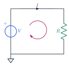
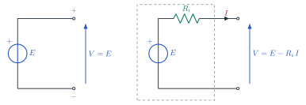
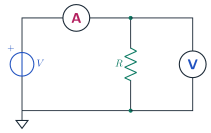
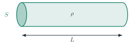
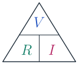
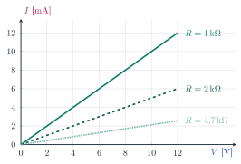
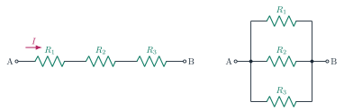
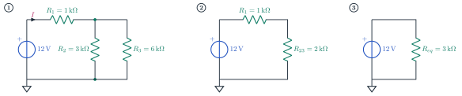
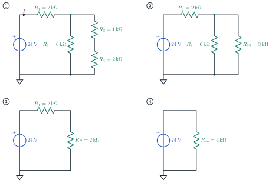

# Voltage, current, resistance and Ohm's law

### TEEA — 3MAT · Topic 1

<a class="btn btn-pdf" href="pdf/01-voltage-current-resistance.pdf" download>Download the explanation as PDF</a>

---

<!-- PDF:INIZIO -->

## The fundamental electrical quantities

Every electrical circuit has three quantities working together: **voltage** pushes the charges, **current** is their movement, and **resistance** opposes that movement.

| Quantity | Symbol | Unit | Instrument | How it is connected |
|---|---|---|---|---|
| voltage | *V* | volt (V) | voltmeter | in **parallel** with the component |
| current | *I* | ampere (A) | ammeter | in **series** with the component |
| resistance | *R* | ohm (Ω) | ohmmeter | on the component **disconnected** from the circuit |

## The electrical circuit

An **electrical circuit** is a closed path in which current can flow. It is made of:

- a **source**, which supplies the energy;
- a **load**, which uses the energy: here a resistance *R*;
- **conductors** (wires), which connect the elements;
- often a **switch**, which opens or closes the circuit.

{: width="300"}

If the circuit is **closed** current flows; if it is **open** (switch open or broken wire) the current is zero.

## Voltage

**Voltage** (or **potential difference**) is the "push" that sets electric charges in motion. It is always measured **between two points** of the circuit.

- Symbol: *V* · unit: **volt** (V).
- Multiples and submultiples: 1 kV = 1000 V · 1 mV = 0.001 V.
- It is marked with the **+** and **−** signs or with an arrow.

A useful comparison is with water: voltage is like the **difference in height** between two tanks; the bigger it is, the harder the water flows.

**Typical values:** AA cell 1.5 V · 9 V battery · USB port 5 V · car battery 12 V · household mains 230 V (alternating).

## Voltage sources

A **voltage source** keeps a voltage between its two terminals, the **positive pole** (+) and the **negative pole** (−), by converting another form of energy into electrical energy: chemical (cell, battery), mechanical (alternator, dynamo), light (photovoltaic panel).

{: width="640"}

- **Ideal source:** the terminal voltage is always equal to *E*, whatever current is delivered.
- **Real source:** it has an **internal resistance** *R*i. When it delivers current, part of the voltage is "lost" inside and less than *E* reaches the terminals.

> **Real source:** *V* = *E* − *R*i · *I*

*E* is called the **electromotive force** (e.m.f.): it is the voltage measured **with no load**, i.e. with the source disconnected (*I* = 0).

**Example.** A battery has *E* = 9 V and *R*i = 1 Ω. If it delivers *I* = 0.5 A, the terminal voltage is *V* = 9 − 1 · 0.5 = **8.5 V**.

In the laboratory we use a **regulated power supply**: a source with adjustable voltage and current limiting, which behaves almost like an ideal source.

## Electric current

**Electric current** is the **ordered movement of electric charges** in a conductor. In metals the moving charges are **electrons**.

**Current intensity** is the amount of charge flowing through a cross-section of the conductor in one second:

> **Current:** *I* = *Q* / *t*

- *Q* = electric charge, in **coulombs** (C); *t* = time, in seconds (s).
- Unit: **ampere** (A); 1 A = 1 C/s.
- Submultiples: 1 mA = 0.001 A · 1 µA = 0.000 001 A.
- **Conventional direction:** outside the source, current flows from the **+** pole to the **−** pole. Electrons actually move the opposite way.

**Example.** *Q* = 6 C flow through the wire in *t* = 3 s: *I* = 6 / 3 = **2 A**.

**Typical values:** LED 10–20 mA · car bulb about 2 A · car starter motor over 100 A.

## Measuring voltage and current

{: width="420"}

- The **ammeter** is connected **in series**: the circuit must be opened so that the current flows through it. Its internal resistance is almost zero.
- The **voltmeter** is connected **in parallel**, across the component. Its internal resistance is very high.
- Careful: an ammeter connected in parallel creates a **short circuit** and may be damaged.

## Resistance

**Electrical resistance** is the **opposition** a material offers to the flow of current.

- Symbol: *R* · unit: **ohm** (Ω).
- Multiples: 1 kΩ = 1000 Ω · 1 MΩ = 1 000 000 Ω.
- **Conductors** (copper, aluminium, silver) have low resistance; **insulators** (plastic, glass, ceramics) very high.

The resistance of a wire depends on its **material**, **length** and **cross-section** (Ohm's second law):

> **Resistance of a wire:** *R* = *ρ* · *L* / *S*

{: width="420"}

| Symbol | Quantity | Unit |
|---|---|---|
| *ρ* (rho) | resistivity of the material | Ω · mm² / m |
| *L* | length of the wire | m |
| *S* | cross-section of the wire | mm² |

The **longer** the wire, the **higher** the resistance; the **thicker** it is, the **lower** the resistance. Copper has *ρ* ≈ 0.0175 Ω · mm²/m.

**Example.** A copper wire 100 m long with a 1.5 mm² cross-section has *R* = 0.0175 · 100 / 1.5 ≈ **1.17 Ω**.

**Resistors** are components built to have a precise resistance value; the value is read from the **colour code** printed on the body.

## Ohm's law

In a resistor the **current** is **directly proportional to the voltage** and **inversely proportional to the resistance**: if the voltage doubles the current doubles, if the resistance doubles the current halves.

> **Current:** *I* = *V* / *R*
>
> **Voltage:** *V* = *R* · *I*
>
> **Resistance:** *R* = *V* / *I*

{: width="200"}

**How to use the triangle:** cover the quantity to calculate with your finger and read the operation that remains. Covering *V* leaves *R* · *I*; covering *I* leaves *V* / *R*; covering *R* leaves *V* / *I*.

### The voltage–current characteristic

If you measure the current for several voltage values and plot the points, you get a **straight line through the origin**: the resistor is a **linear** component. The higher the resistance, the less steep the line.

{: width="560"}

### Watch the units

Formulas use V, A and Ω. In electronics the pair **kΩ and mA** is also handy: volts divided by kilohms gives milliamperes directly.

| Voltage | Resistance | Current |
|---|---|---|
| V | Ω | A |
| V | kΩ | mA |

### Worked examples

- **Finding the current.** *V* = 12 V, *R* = 1 kΩ = 1000 Ω → *I* = 12 / 1000 = 0.012 A = **12 mA**.
- **Finding the voltage.** *R* = 220 Ω, *I* = 50 mA = 0.05 A → *V* = 220 · 0.05 = **11 V**.
- **Finding the resistance.** *V* = 9 V, *I* = 3 mA = 0.003 A → *R* = 9 / 0.003 = 3000 Ω = **3 kΩ**.
- **Using kΩ and mA.** *V* = 5 V, *R* = 2.2 kΩ → *I* = 5 / 2.2 ≈ **2.27 mA**.

## Resistances in series and in parallel

{: width="640"}

### Resistances in series

Resistances are **in series** when they are connected one after another, **with no branches**: the **same current** flows through all of them.

> **Equivalent resistance in series:** *R*eq = *R*1 + *R*2 + *R*3 + …

- The current is **the same** in all the resistances.
- The total voltage is the **sum** of the voltages: *V* = *V*1 + *V*2 + *V*3.
- *R*eq is always **larger** than the largest resistance.

### Resistances in parallel

Resistances are **in parallel** when they are connected **between the same two nodes**: they have **the same voltage** across them.

> **Equivalent resistance in parallel:** 1 / *R*eq = 1 / *R*1 + 1 / *R*2 + 1 / *R*3 + …
>
> **Two resistances in parallel:** *R*eq = *R*1 · *R*2 / (*R*1 + *R*2)
>
> ***n* equal resistances in parallel:** *R*eq = *R* / *n*

- The voltage is **the same** across all the resistances.
- The total current is the **sum** of the currents: *I* = *I*1 + *I*2 + *I*3.
- *R*eq is always **smaller** than the smallest resistance.

The symbol ∥ reads "in parallel with": *R*2 ∥ *R*3.

### How to solve a circuit with series and parallel resistances

- **1.** **Find the groups** of resistances that are clearly in series or in parallel, starting from the part of the circuit **furthest from the source**.
- **2.** **Replace** each group with its equivalent resistance and **redraw** the circuit.
- **3.** **Repeat** until a single resistance is left: the *R*eq seen by the source.
- **4.** Calculate the **total current** with Ohm's law: *I* = *V* / *R*eq.
- **5.** **Go back** through the redrawn circuits and calculate the voltage and current of each resistance with Ohm's law: in series the current is the same, in parallel the voltage is the same.
- **6.** **Check** the results: the voltages in series must add up to the total voltage, the currents in parallel to the total current.

### Worked example 1

*V* = 12 V, *R*1 = 1 kΩ in series with the parallel of *R*2 = 3 kΩ and *R*3 = 6 kΩ.

- **parallel:** *R*23 = *R*2 ∥ *R*3 = 3 · 6 / (3 + 6) = 18 / 9 = **2 kΩ**
- **series:** *R*eq = *R*1 + *R*23 = 1 + 2 = **3 kΩ**
- **total current:** *I* = *V* / *R*eq = 12 V / 3 kΩ = **4 mA** (the current through *R*1)
- **voltage across *R*1:** *V*1 = *R*1 · *I* = 1 kΩ · 4 mA = **4 V**
- **voltage across the parallel:** *V*23 = *R*23 · *I* = 2 kΩ · 4 mA = **8 V** (the same across *R*2 and *R*3)
- **currents in the parallel:** *I*2 = 8 V / 3 kΩ ≈ **2.67 mA** · *I*3 = 8 V / 6 kΩ ≈ **1.33 mA**
- **checks:** 4 + 8 = 12 V ✓ · 2.67 + 1.33 = 4 mA ✓

### Worked example 2

*V* = 24 V, *R*1 = 2 kΩ in series with the parallel of *R*2 = 6 kΩ and the series of *R*3 = 1 kΩ and *R*4 = 2 kΩ.

- **step 2, series:** *R*34 = *R*3 + *R*4 = 1 + 2 = **3 kΩ**
- **step 3, parallel:** *R*P = *R*2 ∥ *R*34 = 6 · 3 / (6 + 3) = 18 / 9 = **2 kΩ**
- **step 4, series:** *R*eq = *R*1 + *R*P = 2 + 2 = **4 kΩ**
- **total current:** *I* = 24 V / 4 kΩ = **6 mA**
- **voltages:** *V*1 = 2 kΩ · 6 mA = **12 V** · *V*P = 2 kΩ · 6 mA = **12 V**
- **currents in the parallel:** *I*2 = 12 V / 6 kΩ = **2 mA** · *I*34 = 12 V / 3 kΩ = **4 mA**
- **voltages across *R*3 and *R*4:** *V*3 = 1 kΩ · 4 mA = **4 V** · *V*4 = 2 kΩ · 4 mA = **8 V**
- **checks:** 12 + 12 = 24 V ✓ · 2 + 4 = 6 mA ✓ · 4 + 8 = 12 V ✓

## Multiples and submultiples

| Prefix | Symbol | Factor | Example |
|---|---|---|---|
| mega | M | 106 = 1 000 000 | 1 MΩ = 1 000 000 Ω |
| kilo | k | 103 = 1000 | 4.7 kΩ = 4700 Ω |
| milli | m | 10−3 = 0.001 | 20 mA = 0.02 A |
| micro | µ | 10−6 = 0.000 001 | 500 µA = 0.0005 A |

## Formula summary

> **Ohm's law:** *V* = *R* · *I*  ;  *I* = *V* / *R*  ;  *R* = *V* / *I*
>
> **Current:** *I* = *Q* / *t*
>
> **Resistance of a wire:** *R* = *ρ* · *L* / *S*
>
> **Real source:** *V* = *E* − *R*i · *I*
>
> **Series:** *R*eq = *R*1 + *R*2 + …
>
> **Parallel:** 1 / *R*eq = 1 / *R*1 + 1 / *R*2 + …  ;  two resistances: *R*eq = *R*1 · *R*2 / (*R*1 + *R*2)

<!-- PDF:FINE -->

---

➡️ To try Ohm's law, the colour code, series and parallel circuits, use the [Ohm's law laboratory](/education/TEEA/3MAT/laboratorio/laboratorio-legge-ohm/) web app *(in Italian)*.

[← Back to TEEA — 3MAT](/education/TEEA/3MAT/index.en.html)
