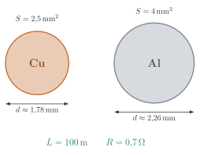
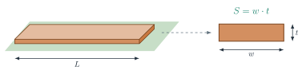
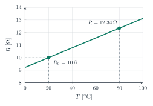
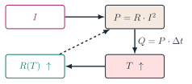
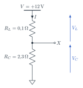
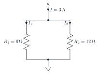

# Resistivity, temperature, power and energy

### TEEA — 3MAT · Topic 3

<a class="btn btn-pdf" href="pdf/03-resistivity-power-energy.pdf" download>Download the explanation as PDF</a> <a class="btn btn-pdf" href="pdf/03-formulario-resistivita-potenza-energia.pdf" download>Download the formula sheet</a>

---

<!-- PDF:INIZIO -->

## The resistance of a conductor

In [topic 1](/education/TEEA/3MAT/programma/01-tensione-corrente-resistenza/index.en.html) we saw that the resistance of a wire depends on the **material**, the **length** and the **cross-section**:

> **Resistance of a conductor:** *R* = *ρ* · *L* / *S*

| Symbol | Quantity | Unit |
|---|---|---|
| *ρ* (rho) | resistivity of the material | Ω · mm² / m |
| *L* | length of the conductor | m |
| *S* | cross-section of the conductor | mm² |

- if the **length** *L* **doubles**, the resistance **doubles**;
- if the **cross-section** *S* **doubles**, the resistance **halves**;
- with the same dimensions, the material with the smaller *ρ* has the smaller resistance: it is a **better conductor**.

For a **round** wire the cross-section is calculated from the diameter *d*: *S* = *π* · *d*2 / 4, and conversely *d* = √(4 · *S* / *π*).

| Material | *ρ* at 20 °C (Ω · mm²/m) | Where it is used |
|---|---|---|
| silver | 0.016 | high-quality contacts |
| **copper** | **0.0175** | building wiring, windings, printed circuit board tracks |
| **aluminium** | **0.028** | overhead high-voltage lines, large distribution cables |
| tungsten | 0.055 | filaments of incandescent lamps |
| constantan | 0.49 | precision resistors, shunts |
| nichrome | 1.1 | heating elements of heaters, ovens, hair dryers |

## Copper or aluminium?

Copper is a better conductor than aluminium: its resistivity is smaller. To get **the same resistance** with aluminium we therefore need a **thicker** conductor. Let's see how much thicker.

### Worked example: same resistance, different materials

A **copper** cable is *L* = 100 m long and has a cross-section *S* = 2.5 mm².

- **resistance of the copper cable:** *R* = 0.0175 · 100 / 2.5 = **0.7 Ω**
- **aluminium cross-section with the same resistance:** from the formula, *S* = *ρ* · *L* / *R* = 0.028 · 100 / 0.7 = **4 mm²**
- **diameters:** copper *d* = √(4 · 2.5 / 3.14) ≈ **1.78 mm**; aluminium *d* = √(4 · 4 / 3.14) ≈ **2.26 mm**

{: width="380"}

What we notice:

- the aluminium **cross-section** is **1.6 times** the copper one: exactly the ratio of the resistivities, 0.028 / 0.0175 = 1.6. The ratio does not depend on the length: it holds for any cable;
- the **diameter** grows less, about 1.26 times (2.26 / 1.78): the aluminium cable is only a little thicker;
- the **weight**, instead, changes a lot. Copper weighs 8.96 g per cm³, aluminium only 2.70 g. One metre of 2.5 mm² copper cable has a volume of 2.5 cm³ and weighs about **22.4 g**; one metre of 4 mm² aluminium cable has a volume of 4 cm³ and weighs about **10.8 g**. For the same resistance, **aluminium weighs less than half**.

> **Same resistance with two materials:** *S*Al / *S*Cu = *ρ*Al / *ρ*Cu = 1.6

**The other way round.** An aluminium cable has a cross-section of 16 mm². Which copper cross-section has the same resistance? *S*Cu = 16 / 1.6 = **10 mm²**.

### Why high-voltage lines are made of aluminium

**Overhead** high-voltage lines have very long conductors, hung from one pylon to the next. Aluminium is the better choice for three reasons:

- for the same resistance the conductor **weighs about half**, so the pylons can be lighter and further apart;
- aluminium **costs less** than copper;
- the thicker conductor cools better in the air.

Aluminium, however, is not very strong in tension: this is why line conductors are made of **aluminium and steel**, with a **core of steel wires** that carries the weight and an **outer layer of aluminium wires** that carries the current.

In **home wiring**, instead, **copper** is used: for the same resistance the cable is thinner and more flexible, it slides more easily into conduits, and the connections in the terminals are more reliable.

## Printed circuit board tracks

The **tracks** of a printed circuit board are strips of copper bonded to the board. Their cross-section is not round but **rectangular**: it is *w* wide (*width*) and *t* thick (*thickness*).

{: width="520"}

> **Rectangular cross-section:** *S* = *w* · *t*

The most common copper thickness is **35 µm** = 0.035 mm. The formula *R* = *ρ* · *L* / *S* stays the same: only the way of calculating the cross-section changes.

### Worked example: resistance of a track

A copper track is *w* = 0.5 mm wide, *t* = 0.035 mm thick and *L* = 100 mm = 0.1 m long.

- **cross-section:** *S* = 0.5 · 0.035 = **0.0175 mm²**
- **resistance:** *R* = 0.0175 · 0.1 / 0.0175 = **0.1 Ω**

Watch the units: the length in **metres**, the cross-section in **mm²**.

| Width *w* | 0.25 mm | 0.5 mm | 1 mm | 2 mm |
|---|---|---|---|---|
| Resistance (*L* = 100 mm, *t* = 35 µm) | 0.2 Ω | 0.1 Ω | 0.05 Ω | 0.025 Ω |

A track twice as wide has half the resistance, just like a wire with twice the cross-section. If 2 A flow in the 0.5 mm track, a voltage of 0.1 · 2 = **0.2 V** is lost across it and the track dissipates *P* = 0.1 · 22 = **0.4 W**, which heat it up. This is why tracks that carry **a lot of current** are drawn **wider** (or with thicker copper, for example 70 µm).

## Electrical power

In [topic 2](/education/TEEA/3MAT/programma/02-partitori-potenza-energia/index.en.html) we saw the three power formulas:

> **Power:** *P* = *V* · *I*  ;  *P* = *R* · *I*2  ;  *P* = *V*2 / *R*

| Known data | Formula to use |
|---|---|
| *V* and *I* | *P* = *V* · *I* |
| *R* and *I* | *P* = *R* · *I*2 |
| *V* and *R* | *P* = *V*2 / *R* |

In a conductor or a resistor all the power turns into **heat** (Joule effect). The formula *P* = *R* · *I*2 is the most useful one for **cables** and **tracks**: the current is the one the load needs, and the power lost grows with the **square** of the current. If the current doubles, the power lost in the cable becomes **four times** larger.

### Worked examples: choosing the resistor power rating

Choose a resistor with a rated power at least **twice** the calculated power. Standard values: 1/4 W, 1/2 W, 1 W, 2 W, 5 W.

- **330 Ω at 12 V.** *P* = *V*2 / *R* = 122 / 330 = 144 / 330 ≈ **0.44 W**. With the margin at least 0.87 W are needed: choose a **1 W** resistor.
- **100 Ω carrying 0.1 A.** *P* = *R* · *I*2 = 100 · 0.12 = **1 W**. With the margin 2 W are needed: choose a **2 W** resistor.
- **Copper cable from the example (0.7 Ω) carrying 10 A.** *P* = 0.7 · 102 = **70 W** dissipated along the cable.

## Energy: from the joule to the watt-hour

Energy is power times operating time: *E* = *P* · *t*. The unit of the International System is the **joule** (J): 1 J = 1 W · 1 s, that is power in watts and time in **seconds**.

The heat produced by the Joule effect in a time interval Δ*t* is:

> **Heat (Joule effect):** *Q* = *P* · Δ*t* = *R* · *I*2 · Δ*t*

With time in seconds *Q* is in joules; with time in hours it is in watt-hours.

### Why the watt-hour is used

The joule is a **very small** unit for electrical appliances. A 1200 W hair dryer switched on for 15 minutes (900 s) uses:

- in joules: *E* = 1200 · 900 = **1,080,000 J**
- in watt-hours: *E* = 1200 · 0.25 = 300 Wh = **0.3 kWh**

> **Conversions:** 1 Wh = 3600 J  ;  1 kWh = 1000 Wh = 3,600,000 J

The **watt-hour** and the **kilowatt-hour** are the units used throughout the world of electrical energy, that is in **distribution** and in **energy accounting**:

- the household **meter** counts the **kWh** used;
- the **electricity bill** shows consumption in **kWh** and the energy price in **€/kWh**;
- the **energy label** of appliances gives consumption in **kWh per year**;
- **batteries** (phones, e-bikes, electric cars) state the energy they hold in **Wh** or **kWh**;
- a **photovoltaic system** states the energy it produces in **kWh**;
- the consumption of a city or a whole country is measured in multiples of the watt-hour: **MWh**, **GWh**, **TWh**.

**This is why, from now on, energy is always calculated in Wh and kWh**, with power in watts and time in **hours**.

## Resistance changes with temperature

When a metal conductor heats up, its resistance **increases**. For temperature changes that are not too large the law is **linear**:

> **Resistance and temperature:** *R*(*T*) = *R*0 · [1 + *α* · (*T* − *T*0)]

| Symbol | Meaning | Unit |
|---|---|---|
| *R*(*T*) | resistance at temperature *T* | Ω |
| *R*0 | resistance at the reference temperature *T*0 (usually 20 °C) | Ω |
| *α* (alpha) | temperature coefficient of the material | 1/°C (°C−1) |
| Δ*T* = *T* − *T*0 | temperature change | °C |

| Material | *α* (1/°C) |
|---|---|
| copper | 0.0039 |
| aluminium | 0.0040 |
| tungsten | 0.0045 |
| constantan | ≈ 0 |

Copper increases its resistance by about **0.4 % per degree**. **Constantan** has an almost zero *α*: its resistance does not change with temperature, which is why it is used in precision resistors.

### Worked example: a coil heating up

A copper winding has *R*0 = 10 Ω at *T*0 = 20 °C. During operation it reaches *T* = 80 °C.

- **temperature change:** Δ*T* = 80 − 20 = **60 °C**
- **hot resistance:** *R* = 10 · (1 + 0.0039 · 60) = 10 · 1.234 = **12.34 Ω**, that is **23 % more**

{: width="420"}

**A hot cable.** The 0.7 Ω copper cable at 20 °C, if it reaches 70 °C, has *R* = 0.7 · (1 + 0.0039 · 50) ≈ **0.84 Ω**.

**Did you know? The incandescent lamp.** The tungsten filament goes from 20 °C to about 2500 °C. A 60 W lamp at 230 V has, when lit, *R* = 2302 / 60 ≈ 882 Ω. With the formula we can estimate that when cold it has about 882 / (1 + 0.0045 · 2480) ≈ **73 Ω**, that is about **12 times less**. This is why at switch-on it draws, for an instant, a much higher current (about 3.2 A instead of 0.26 A), and that is exactly when it often burns out. With such large temperature jumps the linear formula gives only an **estimate**.

## Joule effect and temperature: a chain reaction

The current heats the conductor (Joule effect), the hot conductor has a higher resistance, and the higher resistance changes the power dissipated. A **chain** forms:

{: width="380"}

How the power changes depends on **how the conductor is supplied**.

- **With a fixed current** (for example a cable, carrying the current required by the load): *P* = *R* · *I*2. If *R* increases, **the power increases**: the conductor heats up even more. This is why cables are chosen with a cross-section suited to the current.
- **With a fixed voltage** (for example a resistor connected directly to the mains or to a battery): *P* = *V*2 / *R*. If *R* increases, **the power decreases** and the heating tends to **stabilise**.

### Worked example: the coil cold and hot

The coil from the previous example (10 Ω at 20 °C, 12.34 Ω at 80 °C) runs for 3 h.

| Supply | *P* at 20 °C | *P* at 80 °C | Energy in 3 h at 80 °C |
|---|---|---|---|
| fixed current *I* = 1 A | 10 · 12 = 10 W | 12.34 · 12 ≈ 12.3 W (**+23 %**) | 12.34 · 3 ≈ 37 Wh |
| fixed voltage *V* = 10 V | 102 / 10 = 10 W | 102 / 12.34 ≈ 8.1 W (**−19 %**) | 8.1 · 3 ≈ 24.3 Wh |

When cold, in both cases, 3 h would give 10 · 3 = **30 Wh**. With a fixed voltage the current drops too: *I* = 10 / 12.34 ≈ 0.81 A.

## Energy accounting and cost

To calculate how much is used and how much is spent:

- **1.** read the **power** of each appliance on its rating plate (in W);
- **2.** estimate the **operating hours** per day;
- **3.** calculate the **energy** *E* = *P* · *t* in Wh, then add up the consumptions;
- **4.** convert to **kWh** and multiply by the energy **price**.

> **Cost:** cost [€] = *E* [kWh] · price [€/kWh]

### Worked example: the consumption of a flat

Energy price: **€0.25/kWh**; one month = 30 days.

| Appliance | Power | Use per day | Energy per day | Energy per month |
|---|---|---|---|---|
| LED lamp | 10 W | 5 h | 50 Wh | 1.5 kWh |
| television | 100 W | 4 h | 400 Wh | 12 kWh |
| hair dryer | 1200 W | 10 min ≈ 0.167 h | 200 Wh | 6 kWh |
| computer | 150 W | 3 h | 450 Wh | 13.5 kWh |
| electric oven | 2000 W | 30 min = 0.5 h | 1000 Wh | 30 kWh |
| **total** | | | **2100 Wh = 2.1 kWh** | **63 kWh** |

- **monthly energy cost:** 63 · 0.25 = **€15.75**
- the appliance that weighs most is the **oven**: it has the highest power, even if it stays on only briefly.

The bill also includes fixed charges and taxes: here we calculate only the part due to the energy used.

### Worked example: the energy lost in a cable

A 2.5 mm² copper line carries a current of 10 A to a workshop 50 m away. There are two conductors (outgoing and return), so the total length is 100 m and *R* = **0.7 Ω**, as in the first example. The line works 8 h a day.

- **power lost in the cable:** *P* = 0.7 · 102 = **70 W**
- **energy lost in a day:** 70 · 8 = **560 Wh**
- **energy lost in a month:** 560 · 30 = 16,800 Wh = **16.8 kWh**, that is 16.8 · 0.25 = **€4.20** a month paid just to heat the cable
- **with a 4 mm² copper cable:** *R* = 0.0175 · 100 / 4 ≈ 0.44 Ω, *P* ≈ 44 W, losses ≈ 10.5 kWh a month ≈ **€2.63**

A **4 mm² aluminium** cable has the same resistance (0.7 Ω) as 2.5 mm² copper: **same losses**, but it weighs less than half.

## The voltage divider: line and load in series

A load supplied through a cable is a **series** circuit: the resistance of the **line** *R*L (the two conductors) and the resistance of the **load** *R*C. It is exactly a **voltage divider**: the source voltage is shared between the line and the load, and the load receives **less** than the source voltage.

With the divider formula we find the load voltage **straight away**, without calculating the current first.

{: width="340"}

> **Load voltage:** *V*C = *V* · *R*C / (*R*L + *R*C)
>
> **Voltage lost on the line:** *V*L = *V* · *R*L / (*R*L + *R*C)
>
> **Efficiency:** *η* = *P*C / *P*tot = *V*C / *V*

### Worked example: a 12 V system in a camper van

A *V* = 12 V battery supplies a load with *R*C = 2.3 Ω. The cable is 2.5 mm² copper, 7 m outgoing and 7 m return: *R*L = 0.0175 · 14 / 2.5 ≈ **0.1 Ω**.

- **load voltage (divider):** *V*C = 12 · 2.3 / (0.1 + 2.3) = 12 · 2.3 / 2.4 = **11.5 V**
- **voltage lost on the line:** *V*L = 12 · 0.1 / 2.4 = **0.5 V** (check: 11.5 + 0.5 = 12 V ✓)
- **current:** *I* = 12 / 2.4 = **5 A**
- **powers:** load *P*C = 11.5 · 5 = **57.5 W**; line *P*L = 0.1 · 52 = **2.5 W**; total 12 · 5 = 60 W ✓
- **efficiency:** *η* = 57.5 / 60 ≈ **0.96**, that is 96 %
- **energy in 4 h:** to the load 57.5 · 4 = **230 Wh**; lost in the line 2.5 · 4 = **10 Wh**; supplied by the battery 60 · 4 = **240 Wh**

**If the cable is twice as long** (*R*L = 0.2 Ω): *V*C = 12 · 2.3 / 2.5 ≈ **11.04 V**, *I* = 12 / 2.5 = 4.8 A, *P*C ≈ 53 W, *P*L = 0.2 · 4.82 ≈ 4.6 W, efficiency **92 %**. The load receives less voltage and the line wastes almost twice as much.

In series **the larger resistance dissipates more**: the current is the same and *P* = *R* · *I*2.

## The current divider: loads in parallel

When several loads are connected **in parallel**, they all have the same voltage and the total current is shared among them as in a **current divider**. Each load uses its own share of energy.

{: width="380"}

### Worked example: two loads in parallel

A current *I* = 3 A supplies two resistive loads in parallel: *R*1 = 6 Ω and *R*2 = 12 Ω. They run 5 h a day.

- **currents (divider):** *I*1 = 3 · 12 / (6 + 12) = **2 A**; *I*2 = 3 · 6 / 18 = **1 A** (check: 2 + 1 = 3 A ✓)
- **voltage across them:** *V* = *R*1 · *I*1 = 6 · 2 = **12 V**
- **powers:** *P*1 = 6 · 22 = **24 W**; *P*2 = 12 · 12 = **12 W**; total 12 · 3 = 36 W ✓
- **energy in a day:** *E*1 = 24 · 5 = **120 Wh**; *E*2 = 12 · 5 = **60 Wh**; total **180 Wh**
- **in a month:** 180 · 30 = 5400 Wh = 5.4 kWh, that is 5.4 · 0.25 = **€1.35**

In parallel **the smaller resistance dissipates more**: the voltage is the same and *P* = *V*2 / *R*. It is the opposite of what happens in series.

**Comparison.** The same two resistances connected **in series** at 12 V: *I* = 12 / 18 ≈ 0.67 A; *P*1 = 6 · 0.672 ≈ 2.7 W; *P*2 = 12 · 0.672 ≈ 5.3 W. Now it is the **larger** resistance that dissipates more.

## Formula summary

> **Resistance of a conductor:** *R* = *ρ* · *L* / *S*  ;  round wire *S* = *π* · *d*2 / 4  ;  track *S* = *w* · *t*
>
> **Same resistance with two materials:** *S*Al / *S*Cu = *ρ*Al / *ρ*Cu = 1.6
>
> **Temperature:** *R*(*T*) = *R*0 · [1 + *α* · (*T* − *T*0)]
>
> **Power:** *P* = *V* · *I*  ;  *P* = *R* · *I*2  ;  *P* = *V*2 / *R*
>
> **Heat and energy:** *Q* = *R* · *I*2 · Δ*t*  ;  *E* = *P* · *t* (W · h = Wh)  ;  1 Wh = 3600 J
>
> **Cost:** cost = *E* [kWh] · price [€/kWh]
>
> **Line and load:** *V*C = *V* · *R*C / (*R*L + *R*C)  ;  *η* = *V*C / *V*
>
> **Loads in parallel:** *I*1 = *I* · *R*2 / (*R*1 + *R*2)  ;  *I*2 = *I* · *R*1 / (*R*1 + *R*2)

<!-- PDF:FINE -->

---

✏️ Practice: [exercises](/education/TEEA/3MAT/materiali/esercitazione-resistivita-potenza-energia-3MAT.pdf), [solutions](/education/TEEA/3MAT/materiali/soluzioni-esercitazione-resistivita-potenza-energia-3MAT.pdf) and [formula sheet](pdf/03-formulario-resistivita-potenza-energia.pdf) *(in Italian)*.

➡️ To try power and energy, use the [Ohm's law laboratory](/education/TEEA/3MAT/laboratorio/laboratorio-legge-ohm/) web app *(in Italian)*.

[← Back to TEEA — 3MAT](/education/TEEA/3MAT/index.en.html)
