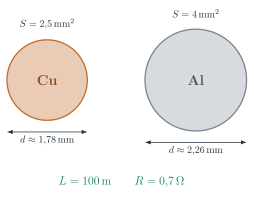
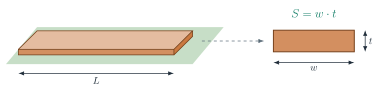
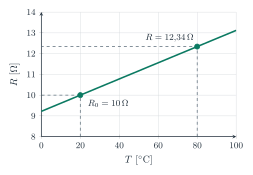
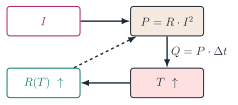
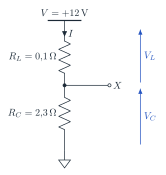
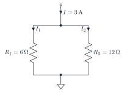

# Resistività, temperatura, potenza ed energia

### TEEA — 3MAT · Argomento 3

<a class="btn btn-pdf" href="pdf/03-resistivita-potenza-energia.pdf" download>Scarica la spiegazione in PDF</a> <a class="btn btn-pdf" href="pdf/03-formulario-resistivita-potenza-energia.pdf" download>Scarica il formulario</a>

---

<!-- PDF:INIZIO -->

## La resistenza di un conduttore

Nell'[argomento 1](/education/TEEA/3MAT/programma/01-tensione-corrente-resistenza/) abbiamo visto che la resistenza di un filo dipende dal **materiale**, dalla **lunghezza** e dalla **sezione**:

> **Resistenza di un conduttore:** *R* = *ρ* · *L* / *S*

| Simbolo | Grandezza | Unità di misura |
|---|---|---|
| *ρ* (rho) | resistività del materiale | Ω · mm² / m |
| *L* | lunghezza del conduttore | m |
| *S* | sezione del conduttore | mm² |

- se **raddoppia la lunghezza** *L*, la resistenza **raddoppia**;
- se **raddoppia la sezione** *S*, la resistenza **si dimezza**;
- a parità di dimensioni, il materiale con *ρ* più piccola ha la resistenza più piccola: è un **conduttore migliore**.

Per un filo **tondo** la sezione si calcola dal diametro *d*: *S* = *π* · *d*2 / 4, e al contrario *d* = √(4 · *S* / *π*).

| Materiale | *ρ* a 20 °C (Ω · mm²/m) | Dove si usa |
|---|---|---|
| argento | 0,016 | contatti di qualità |
| **rame** | **0,0175** | cavi degli impianti, avvolgimenti, piste dei circuiti stampati |
| **alluminio** | **0,028** | linee aeree di alta tensione, grandi cavi di distribuzione |
| tungsteno | 0,055 | filamenti delle lampade a incandescenza |
| costantana | 0,49 | resistori di precisione, shunt |
| nichel-cromo | 1,1 | resistenze di stufe, forni, asciugacapelli |

## Rame o alluminio?

Il rame conduce meglio dell'alluminio: la sua resistività è più piccola. Per avere **la stessa resistenza** con l'alluminio bisogna quindi usare un conduttore **più grosso**. Vediamo di quanto.

### Esempio svolto: stessa resistenza, materiali diversi

Un cavo di **rame** lungo *L* = 100 m ha sezione *S* = 2,5 mm².

- **resistenza del cavo di rame:** *R* = 0,0175 · 100 / 2,5 = **0,7 Ω**
- **sezione di alluminio con la stessa resistenza:** dalla formula si ricava *S* = *ρ* · *L* / *R* = 0,028 · 100 / 0,7 = **4 mm²**
- **diametri:** rame *d* = √(4 · 2,5 / 3,14) ≈ **1,78 mm**; alluminio *d* = √(4 · 4 / 3,14) ≈ **2,26 mm**

{: width="380"}

Che cosa si nota:

- la **sezione** dell'alluminio è **1,6 volte** quella del rame: è proprio il rapporto tra le resistività, 0,028 / 0,0175 = 1,6. Il rapporto non dipende dalla lunghezza: vale per qualunque cavo;
- il **diametro** cresce di meno, circa 1,26 volte (2,26 / 1,78): il cavo in alluminio è solo un po' più grosso;
- il **peso** invece cambia molto. Il rame pesa 8,96 g per ogni cm³, l'alluminio solo 2,70 g. Un metro di cavo di rame da 2,5 mm² ha un volume di 2,5 cm³ e pesa circa **22,4 g**; un metro di cavo di alluminio da 4 mm² ha un volume di 4 cm³ e pesa circa **10,8 g**. A parità di resistenza, **l'alluminio pesa meno della metà**.

> **Stessa resistenza con due materiali:** *S*Al / *S*Cu = *ρ*Al / *ρ*Cu = 1,6

**Esempio al contrario.** Un cavo di alluminio ha sezione 16 mm². Quale sezione di rame ha la stessa resistenza? *S*Cu = 16 / 1,6 = **10 mm²**.

### Perché le linee di alta tensione sono in alluminio

Le **linee aeree** di alta tensione hanno conduttori lunghissimi, sospesi tra un traliccio e l'altro. Usare l'alluminio conviene per tre motivi:

- a parità di resistenza il conduttore **pesa circa la metà**, quindi i tralicci possono essere meno robusti e più distanti tra loro;
- l'alluminio **costa meno** del rame;
- il conduttore più grosso si raffredda meglio all'aria.

L'alluminio però è poco resistente alla trazione: per questo i conduttori delle linee sono di **alluminio-acciaio**, con un'**anima di fili d'acciaio** che regge il peso e una **corona di fili di alluminio** che porta la corrente.

Negli **impianti delle case** invece si usa il **rame**: a parità di resistenza il cavo è più sottile e flessibile, entra più facilmente nei tubi e i collegamenti nei morsetti sono più affidabili.

## Le piste dei circuiti stampati

Le **piste** di un circuito stampato sono strisce di rame incollate sulla basetta. La loro sezione non è tonda ma **rettangolare**: è larga *w* (*width*, larghezza) e spessa *t* (*thickness*, spessore).

{: width="520"}

> **Sezione rettangolare:** *S* = *w* · *t*

Lo spessore del rame più comune è **35 µm** = 0,035 mm. La formula *R* = *ρ* · *L* / *S* resta la stessa: cambia solo il modo di calcolare la sezione.

### Esempio svolto: resistenza di una pista

Una pista di rame è larga *w* = 0,5 mm, spessa *t* = 0,035 mm e lunga *L* = 100 mm = 0,1 m.

- **sezione:** *S* = 0,5 · 0,035 = **0,0175 mm²**
- **resistenza:** *R* = 0,0175 · 0,1 / 0,0175 = **0,1 Ω**

Attenzione alle unità: la lunghezza va in **metri**, la sezione in **mm²**.

| Larghezza *w* | 0,25 mm | 0,5 mm | 1 mm | 2 mm |
|---|---|---|---|---|
| Resistenza (*L* = 100 mm, *t* = 35 µm) | 0,2 Ω | 0,1 Ω | 0,05 Ω | 0,025 Ω |

Una pista larga il doppio ha metà resistenza, come un filo con sezione doppia. Se nella pista da 0,5 mm passano 2 A, ai suoi capi si perde una tensione di 0,1 · 2 = **0,2 V** e la pista dissipa *P* = 0,1 · 22 = **0,4 W**, che la scaldano. Per questo le piste che portano **molta corrente** si disegnano **più larghe** (o con rame più spesso, per esempio 70 µm).

## La potenza elettrica

Nell'[argomento 2](/education/TEEA/3MAT/programma/02-partitori-potenza-energia/) abbiamo visto le tre formule della potenza:

> **Potenza:** *P* = *V* · *I*  ;  *P* = *R* · *I*2  ;  *P* = *V*2 / *R*

| Dati noti | Formula da usare |
|---|---|
| *V* e *I* | *P* = *V* · *I* |
| *R* e *I* | *P* = *R* · *I*2 |
| *V* e *R* | *P* = *V*2 / *R* |

In un conduttore o in un resistore tutta la potenza diventa **calore** (effetto Joule). La formula *P* = *R* · *I*2 è la più utile per i **cavi** e le **piste**: la corrente è quella che serve al carico, e la potenza persa cresce con il **quadrato** della corrente. Se la corrente raddoppia, la potenza persa nel cavo diventa **quattro volte** più grande.

### Esempi svolti: scegliere la potenza del resistore

Si sceglie un resistore con potenza nominale almeno **doppia** di quella calcolata. Valori commerciali: 1/4 W, 1/2 W, 1 W, 2 W, 5 W.

- **330 Ω a 12 V.** *P* = *V*2 / *R* = 122 / 330 = 144 / 330 ≈ **0,44 W**. Con il margine servono almeno 0,87 W: si sceglie un resistore da **1 W**.
- **100 Ω attraversato da 0,1 A.** *P* = *R* · *I*2 = 100 · 0,12 = **1 W**. Con il margine servono 2 W: si sceglie un resistore da **2 W**.
- **Cavo di rame dell'esempio (0,7 Ω) con 10 A.** *P* = 0,7 · 102 = **70 W** dissipati lungo il cavo.

## L'energia: dal joule al wattora

L'energia è la potenza per il tempo di funzionamento: *E* = *P* · *t*. L'unità di misura del Sistema Internazionale è il **joule** (J): 1 J = 1 W · 1 s, cioè potenza in watt e tempo in **secondi**.

Il calore prodotto per effetto Joule in un intervallo di tempo Δ*t* è:

> **Calore (effetto Joule):** *Q* = *P* · Δ*t* = *R* · *I*2 · Δ*t*

Con il tempo in secondi *Q* è in joule; con il tempo in ore è in wattora.

### Perché si usa il wattora

Il joule è un'unità **molto piccola** per gli apparecchi elettrici. Un asciugacapelli da 1200 W acceso per 15 minuti (900 s) consuma:

- in joule: *E* = 1200 · 900 = **1 080 000 J**
- in wattora: *E* = 1200 · 0,25 = 300 Wh = **0,3 kWh**

> **Conversioni:** 1 Wh = 3600 J  ;  1 kWh = 1000 Wh = 3 600 000 J

Il **wattora** e il **kilowattora** sono le unità usate in tutto il mondo dell'energia elettrica, cioè nella **distribuzione** e nel **computo dei consumi**:

- il **contatore** di casa conta i **kWh** consumati;
- la **bolletta** riporta i consumi in **kWh** e il prezzo dell'energia in **€/kWh**;
- l'**etichetta energetica** degli elettrodomestici indica il consumo in **kWh all'anno**;
- le **batterie** (telefoni, bici elettriche, auto elettriche) indicano l'energia che contengono in **Wh** o **kWh**;
- un **impianto fotovoltaico** dichiara l'energia prodotta in **kWh**;
- i consumi di una città o di un intero Paese si misurano in multipli del wattora: **MWh**, **GWh**, **TWh**.

**Per questo, da qui in avanti, l'energia si calcola sempre in Wh e kWh**, con la potenza in watt e il tempo in **ore**.

## La resistenza cambia con la temperatura

Quando un conduttore metallico si scalda, la sua resistenza **aumenta**. Per variazioni di temperatura non troppo grandi la legge è **lineare**:

> **Resistenza e temperatura:** *R*(*T*) = *R*0 · [1 + *α* · (*T* − *T*0)]

| Simbolo | Significato | Unità di misura |
|---|---|---|
| *R*(*T*) | resistenza alla temperatura *T* | Ω |
| *R*0 | resistenza alla temperatura di riferimento *T*0 (di solito 20 °C) | Ω |
| *α* (alfa) | coefficiente di temperatura del materiale | 1/°C (°C−1) |
| Δ*T* = *T* − *T*0 | variazione di temperatura | °C |

| Materiale | *α* (1/°C) |
|---|---|
| rame | 0,0039 |
| alluminio | 0,0040 |
| tungsteno | 0,0045 |
| costantana | ≈ 0 |

Il rame aumenta la sua resistenza di circa lo **0,4 % per ogni grado**. La **costantana** ha *α* quasi nullo: la sua resistenza non cambia con la temperatura, per questo si usa nei resistori di precisione.

### Esempio svolto: una bobina che si scalda

Un avvolgimento in rame ha *R*0 = 10 Ω a *T*0 = 20 °C. Durante il funzionamento arriva a *T* = 80 °C.

- **variazione di temperatura:** Δ*T* = 80 − 20 = **60 °C**
- **resistenza a caldo:** *R* = 10 · (1 + 0,0039 · 60) = 10 · 1,234 = **12,34 Ω**, cioè il **23 % in più**

{: width="420"}

**Un cavo caldo.** Il cavo di rame da 0,7 Ω a 20 °C, se arriva a 70 °C, ha *R* = 0,7 · (1 + 0,0039 · 50) ≈ **0,84 Ω**.

**Curiosità: la lampada a incandescenza.** Il filamento di tungsteno passa da 20 °C a circa 2500 °C. Una lampada da 60 W a 230 V da accesa ha *R* = 2302 / 60 ≈ 882 Ω. Con la formula si stima che da fredda abbia circa 882 / (1 + 0,0045 · 2480) ≈ **73 Ω**, cioè circa **12 volte meno**. Per questo all'accensione assorbe per un attimo una corrente molto più alta (circa 3,2 A invece di 0,26 A) ed è proprio in quel momento che spesso si brucia. Con salti di temperatura così grandi la formula lineare dà solo una **stima**.

## Effetto Joule e temperatura: un legame a catena

La corrente scalda il conduttore (effetto Joule), il conduttore caldo ha una resistenza più alta, e la resistenza più alta cambia la potenza dissipata. Si forma una **catena**:

{: width="380"}

Come cambia la potenza dipende da **come è alimentato** il conduttore.

- **A corrente imposta** (per esempio un cavo, in cui passa la corrente richiesta dal carico): *P* = *R* · *I*2. Se *R* aumenta, **la potenza aumenta**: il conduttore si scalda ancora di più. Per questo i cavi si scelgono con una sezione adatta alla corrente.
- **A tensione imposta** (per esempio una resistenza collegata direttamente alla rete o a una batteria): *P* = *V*2 / *R*. Se *R* aumenta, **la potenza diminuisce** e il riscaldamento tende a **stabilizzarsi**.

### Esempio svolto: la bobina a freddo e a caldo

La bobina dell'esempio precedente (10 Ω a 20 °C, 12,34 Ω a 80 °C) funziona per 3 h.

| Alimentazione | *P* a 20 °C | *P* a 80 °C | Energia in 3 h a 80 °C |
|---|---|---|---|
| corrente imposta *I* = 1 A | 10 · 12 = 10 W | 12,34 · 12 ≈ 12,3 W (**+23 %**) | 12,34 · 3 ≈ 37 Wh |
| tensione imposta *V* = 10 V | 102 / 10 = 10 W | 102 / 12,34 ≈ 8,1 W (**−19 %**) | 8,1 · 3 ≈ 24,3 Wh |

A freddo, in tutti e due i casi, in 3 h si avrebbero 10 · 3 = **30 Wh**. Con la tensione imposta anche la corrente cala: *I* = 10 / 12,34 ≈ 0,81 A.

## Il computo energetico e la spesa

Per calcolare quanto si consuma e quanto si spende:

- **1.** per ogni apparecchio si legge la **potenza** sulla targa (in W);
- **2.** si stimano le **ore di funzionamento** al giorno;
- **3.** si calcola l'**energia** *E* = *P* · *t* in Wh, poi si sommano i consumi;
- **4.** si passa ai **kWh** e si moltiplica per il **prezzo** dell'energia.

> **Costo:** costo [€] = *E* [kWh] · prezzo [€/kWh]

### Esempio svolto: i consumi di un appartamento

Prezzo dell'energia: **0,25 €/kWh**; un mese = 30 giorni.

| Apparecchio | Potenza | Uso al giorno | Energia al giorno | Energia al mese |
|---|---|---|---|---|
| lampada LED | 10 W | 5 h | 50 Wh | 1,5 kWh |
| televisore | 100 W | 4 h | 400 Wh | 12 kWh |
| asciugacapelli | 1200 W | 10 min ≈ 0,167 h | 200 Wh | 6 kWh |
| computer | 150 W | 3 h | 450 Wh | 13,5 kWh |
| forno elettrico | 2000 W | 30 min = 0,5 h | 1000 Wh | 30 kWh |
| **totale** | | | **2100 Wh = 2,1 kWh** | **63 kWh** |

- **spesa mensile per l'energia:** 63 · 0,25 = **15,75 €**
- l'apparecchio che pesa di più è il **forno**: ha la potenza più alta, anche se resta acceso poco.

In bolletta si pagano anche quote fisse e imposte: qui si calcola solo la parte dovuta all'energia consumata.

### Esempio svolto: l'energia persa in un cavo

Una linea in rame da 2,5 mm² porta una corrente di 10 A a un capannone distante 50 m. I conduttori sono due (andata e ritorno), quindi la lunghezza totale è 100 m e *R* = **0,7 Ω**, come nel primo esempio. La linea lavora 8 h al giorno.

- **potenza persa nel cavo:** *P* = 0,7 · 102 = **70 W**
- **energia persa in un giorno:** 70 · 8 = **560 Wh**
- **energia persa in un mese:** 560 · 30 = 16 800 Wh = **16,8 kWh**, cioè 16,8 · 0,25 = **4,20 €** al mese pagati solo per scaldare il cavo
- **con un cavo di rame da 4 mm²:** *R* = 0,0175 · 100 / 4 ≈ 0,44 Ω, *P* ≈ 44 W, perdite ≈ 10,5 kWh al mese ≈ **2,63 €**

Un cavo in **alluminio da 4 mm²** ha la stessa resistenza (0,7 Ω) del rame da 2,5 mm²: **stesse perdite**, ma pesa meno della metà.

## Il partitore di tensione: linea e carico in serie

Un carico alimentato attraverso un cavo è un circuito **in serie**: la resistenza della **linea** *R*L (i due conduttori) e la resistenza del **carico** *R*C. È proprio un **partitore di tensione**: la tensione del generatore si divide tra la linea e il carico, e al carico arriva **meno** della tensione del generatore.

Con la formula del partitore si trova **subito** la tensione sul carico, senza passare dalla corrente.

{: width="340"}

> **Tensione sul carico:** *V*C = *V* · *R*C / (*R*L + *R*C)
>
> **Tensione persa sulla linea:** *V*L = *V* · *R*L / (*R*L + *R*C)
>
> **Rendimento:** *η* = *P*C / *P*tot = *V*C / *V*

### Esempio svolto: un impianto a 12 V in camper

Una batteria da *V* = 12 V alimenta un carico con *R*C = 2,3 Ω. Il cavo è di rame da 2,5 mm², con 7 m di andata e 7 m di ritorno: *R*L = 0,0175 · 14 / 2,5 ≈ **0,1 Ω**.

- **tensione sul carico (partitore):** *V*C = 12 · 2,3 / (0,1 + 2,3) = 12 · 2,3 / 2,4 = **11,5 V**
- **tensione persa sulla linea:** *V*L = 12 · 0,1 / 2,4 = **0,5 V** (verifica: 11,5 + 0,5 = 12 V ✓)
- **corrente:** *I* = 12 / 2,4 = **5 A**
- **potenze:** carico *P*C = 11,5 · 5 = **57,5 W**; linea *P*L = 0,1 · 52 = **2,5 W**; totale 12 · 5 = 60 W ✓
- **rendimento:** *η* = 57,5 / 60 ≈ **0,96**, cioè il 96 %
- **energia in 4 h:** al carico 57,5 · 4 = **230 Wh**; persa nella linea 2,5 · 4 = **10 Wh**; fornita dalla batteria 60 · 4 = **240 Wh**

**Se il cavo è lungo il doppio** (*R*L = 0,2 Ω): *V*C = 12 · 2,3 / 2,5 ≈ **11,04 V**, *I* = 12 / 2,5 = 4,8 A, *P*C ≈ 53 W, *P*L = 0,2 · 4,82 ≈ 4,6 W, rendimento **92 %**. Il carico riceve meno tensione e la linea spreca quasi il doppio.

In serie **dissipa di più la resistenza più grande**: la corrente è la stessa e *P* = *R* · *I*2.

## Il partitore di corrente: carichi in parallelo

Quando più carichi sono collegati **in parallelo**, hanno tutti la stessa tensione e la corrente totale si divide tra loro come in un **partitore di corrente**. Ogni carico consuma la sua parte di energia.

{: width="380"}

### Esempio svolto: due carichi in parallelo

Una corrente *I* = 3 A alimenta due carichi resistivi in parallelo: *R*1 = 6 Ω e *R*2 = 12 Ω. Funzionano 5 h al giorno.

- **correnti (partitore):** *I*1 = 3 · 12 / (6 + 12) = **2 A**; *I*2 = 3 · 6 / 18 = **1 A** (verifica: 2 + 1 = 3 A ✓)
- **tensione ai capi:** *V* = *R*1 · *I*1 = 6 · 2 = **12 V**
- **potenze:** *P*1 = 6 · 22 = **24 W**; *P*2 = 12 · 12 = **12 W**; totale 12 · 3 = 36 W ✓
- **energia in un giorno:** *E*1 = 24 · 5 = **120 Wh**; *E*2 = 12 · 5 = **60 Wh**; totale **180 Wh**
- **in un mese:** 180 · 30 = 5400 Wh = 5,4 kWh, cioè 5,4 · 0,25 = **1,35 €**

In parallelo **dissipa di più la resistenza più piccola**: la tensione è la stessa e *P* = *V*2 / *R*. È il contrario di quello che succede in serie.

**Confronto.** Le stesse due resistenze collegate **in serie** a 12 V: *I* = 12 / 18 ≈ 0,67 A; *P*1 = 6 · 0,672 ≈ 2,7 W; *P*2 = 12 · 0,672 ≈ 5,3 W. Ora è la resistenza **più grande** a dissipare di più.

## Riepilogo delle formule

> **Resistenza di un conduttore:** *R* = *ρ* · *L* / *S*  ;  filo tondo *S* = *π* · *d*2 / 4  ;  pista *S* = *w* · *t*
>
> **Stessa resistenza con due materiali:** *S*Al / *S*Cu = *ρ*Al / *ρ*Cu = 1,6
>
> **Temperatura:** *R*(*T*) = *R*0 · [1 + *α* · (*T* − *T*0)]
>
> **Potenza:** *P* = *V* · *I*  ;  *P* = *R* · *I*2  ;  *P* = *V*2 / *R*
>
> **Calore ed energia:** *Q* = *R* · *I*2 · Δ*t*  ;  *E* = *P* · *t* (W · h = Wh)  ;  1 Wh = 3600 J
>
> **Costo:** costo = *E* [kWh] · prezzo [€/kWh]
>
> **Linea e carico:** *V*C = *V* · *R*C / (*R*L + *R*C)  ;  *η* = *V*C / *V*
>
> **Carichi in parallelo:** *I*1 = *I* · *R*2 / (*R*1 + *R*2)  ;  *I*2 = *I* · *R*1 / (*R*1 + *R*2)

<!-- PDF:FINE -->

---

✏️ Per allenarti: [esercizi](/education/TEEA/3MAT/materiali/esercitazione-resistivita-potenza-energia-3MAT.pdf), [soluzioni](/education/TEEA/3MAT/materiali/soluzioni-esercitazione-resistivita-potenza-energia-3MAT.pdf) e [formulario](pdf/03-formulario-resistivita-potenza-energia.pdf).

➡️ Per provare potenza ed energia usa la web app [Laboratorio legge di Ohm](/education/TEEA/3MAT/laboratorio/laboratorio-legge-ohm/).

[← Torna a TEEA — 3MAT](/education/TEEA/3MAT/)
