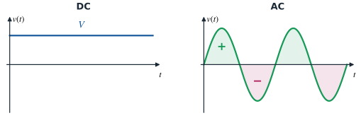
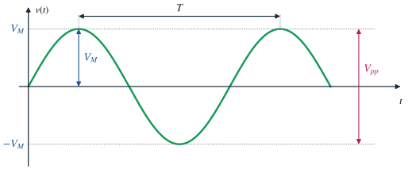
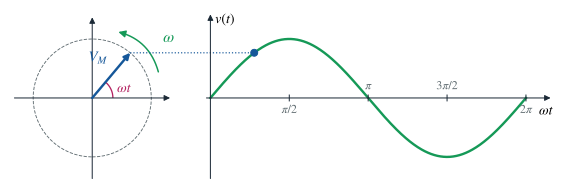
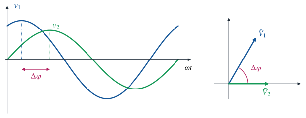

# Segnali elettrici continui e alternati

### TEEA — 4MAT · Argomento 1

<a class="btn btn-pdf" href="pdf/01-segnali-continui-alternati.pdf" download>Scarica la spiegazione in PDF</a>

---

<!-- PDF:INIZIO -->

## Il segnale elettrico

Un **segnale elettrico** è una grandezza elettrica, **tensione** o **corrente**, che porta un'informazione o un'energia e che può variare nel tempo.

Per distinguere i valori si usa una convenzione sui simboli:

- **lettera minuscola** → valore istantaneo, cioè il valore in un preciso istante: *v*(*t*), *i*(*t*);
- **lettera maiuscola** → valore costante o caratteristico: *V*, *I*, *V*M, *I*M.

## Segnale continuo e segnale alternato

### Segnale continuo (DC)

Un segnale **continuo** (*DC – Direct Current*) mantiene nel tempo **lo stesso valore e lo stesso verso**.

- Sul grafico tensione–tempo è una **retta orizzontale**.
- Si indica con *V* (tensione) e *I* (corrente).
- Esempi: pila, batteria dell'auto (12 V), alimentatore da laboratorio, porta USB (5 V).

### Segnale alternato (AC)

Un segnale **alternato** (*AC – Alternating Current*) **cambia periodicamente valore e verso**: si ripete sempre uguale nel tempo e assume valori positivi e negativi.

- In un periodo il **valore medio è zero**: l'area della semionda positiva è uguale a quella della semionda negativa.
- Esempio tipico: la **rete elettrica** domestica (230 V, 50 Hz).

## La sinusoide

La forma d'onda alternata più importante è la **sinusoide**. Il valore istantaneo della tensione e della corrente si scrive:

> **Tensione:** *v*(*t*) = *V*M · sin(*ω t* + *φ*)
>
> **Corrente:** *i*(*t*) = *I*M · sin(*ω t* + *φ*)

| Simbolo | Grandezza | Unità di misura | Significato |
|---|---|---|---|
| *V*M, *I*M | ampiezza (valore massimo o di picco) | V, A | il valore più alto raggiunto dalla sinusoide |
| *V*pp | valore picco-picco | V | distanza tra il massimo e il minimo: *V*pp = 2 · *V*M |
| *T* | periodo | s (secondi) | tempo impiegato per compiere un'oscillazione completa |
| *f* | frequenza | Hz (hertz) | numero di oscillazioni complete in un secondo |
| *ω* | pulsazione (omega) | rad/s | velocità angolare con cui ruota il fasore |
| *φ* | fase iniziale (fi) | rad oppure ° | posizione della sinusoide all'istante *t* = 0 |
| *ω t* + *φ* | fase (angolo istantaneo) | rad | angolo raggiunto all'istante *t* |

## Formule fondamentali

> **Frequenza e periodo:** *f* = 1 / *T*  ⟺  *T* = 1 / *f*
>
> **Pulsazione:** *ω* = 2π · *f* = 2π / *T*
>
> **Valore picco-picco:** *V*pp = 2 · *V*M

Frequenza e periodo sono **inversamente proporzionali**: se la frequenza raddoppia, il periodo si dimezza.

**Multipli e sottomultipli utili:** 1 kHz = 103 Hz · 1 MHz = 106 Hz · 1 ms = 10−3 s · 1 µs = 10−6 s

## Gli angoli in radianti

In elettrotecnica gli angoli si misurano di solito in **radianti** (rad). Un giro completo vale **2π rad**, cioè 360°.

> **Da gradi a radianti:** *α*rad = *α*° · π / 180
>
> **Da radianti a gradi:** *α*° = *α*rad · 180 / π

| Gradi | 0° | 30° | 45° | 60° | 90° | 180° | 270° | 360° |
|---|---|---|---|---|---|---|---|---|
| **Radianti** | 0 | π/6 | π/4 | π/3 | π/2 | π | 3π/2 | 2π |

Per questo la pulsazione si chiama anche **velocità angolare**: in un periodo *T* il fasore compie un giro, cioè percorre 2π rad, quindi *ω* = 2π / *T*.

## La rappresentazione a fasori

Disegnare e sommare sinusoidi è scomodo. Per questo ogni sinusoide si rappresenta con un **fasore**: un **vettore che ruota in senso antiorario** attorno all'origine.

- La **lunghezza** del fasore è l'**ampiezza** *V*M.
- La **velocità di rotazione** è la **pulsazione** *ω*.
- L'**angolo iniziale**, misurato dall'asse orizzontale in senso antiorario, è la **fase iniziale** *φ*.
- La **proiezione sull'asse verticale** del fasore che ruota disegna, istante per istante, la **sinusoide** *v*(*t*).

Il fasore si indica con una lettera maiuscola soprassegnata, **V̄**, e si scrive in forma polare:

> **Fasore:** V̄ = *V*M ∠ *φ*

Quando tutte le grandezze hanno la **stessa frequenza**, i fasori ruotano insieme e mantengono gli stessi angoli tra loro. Si possono quindi disegnare **fermi**, nella posizione che hanno a *t* = 0: è il **diagramma fasoriale**.

## La fase e lo sfasamento

La **fase iniziale** *φ* indica da dove parte la sinusoide all'istante *t* = 0. Confrontando due sinusoidi **con la stessa frequenza** si definisce lo **sfasamento**:

> **Sfasamento:** Δ*φ* = *φ*1 − *φ*2

Nel diagramma fasoriale lo sfasamento è semplicemente l'**angolo tra i due fasori**.

- **in fase** (Δ*φ* = 0): raggiungono il massimo nello stesso istante;
- **in anticipo** (Δ*φ* > 0): la prima raggiunge il massimo prima della seconda (nella figura *v*1 è in anticipo su *v*2);
- **in ritardo** (Δ*φ* < 0): la prima raggiunge il massimo dopo la seconda;
- **in opposizione di fase** (Δ*φ* = π rad = 180°): quando una è al massimo, l'altra è al minimo;
- **in quadratura** (Δ*φ* = π/2 rad = 90°).

Lo sfasamento si può esprimere anche come ritardo nel tempo: Δ*t* = Δ*φ* / *ω*.

## Esempio: la rete elettrica

Per la rete domestica *f* = 50 Hz:

- **periodo:** *T* = 1 / *f* = 1 / 50 = 0,02 s = **20 ms**
- **pulsazione:** *ω* = 2π · *f* = 2π · 50 ≈ **314 rad/s**
- **ampiezza:** i 230 V sono il *valore efficace*; il valore massimo è *V*M = 230 · √2 ≈ **325 V**, quindi *V*pp ≈ 650 V
- **espressione:** *v*(*t*) ≈ 325 · sin(314 *t*) V

<!-- PDF:FINE -->

---

➡️ Per vedere sinusoidi, fasori e sfasamento in movimento usa la web app [Corrente alternata](/education/TEEA/4MAT/laboratorio/ca/).

[← Torna a TEEA — 4MAT](/education/TEEA/4MAT/)
