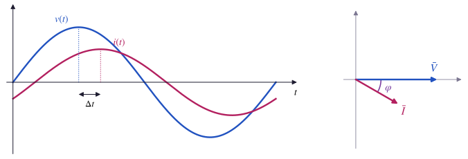
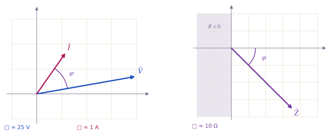
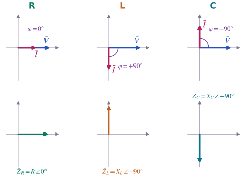
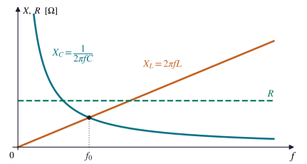
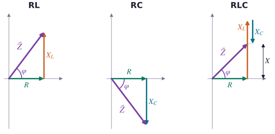
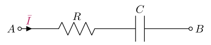
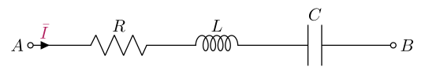
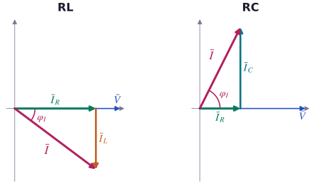
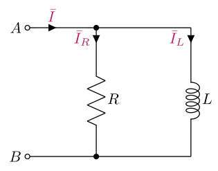
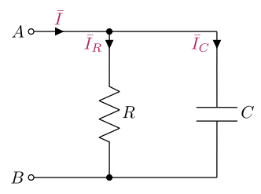

# Impedance

### TEEA — 4MAT · Topic 2

<a class="btn btn-pdf" href="pdf/02-impedance.pdf" download>Download the explanation as PDF</a> <a class="btn btn-pdf" href="pdf/02-formulario-impedenza.pdf" download>Download the formula sheet (in Italian)</a>

---

<!-- PDF:INIZIO -->

In DC a resistor is described by a single number, its resistance *R*. In AC a load does **two things**: it **limits** the current and it **shifts** it with respect to the voltage. So two numbers are needed to describe it, a magnitude and an angle: this is the **impedance**.

This lesson uses phasors only: magnitudes, angles, Pythagoras' theorem and the arctangent.

Conventions of this lesson

- The **length of a phasor** is the **RMS value**: the mains voltage is written V̄ = 230 V ∠ 0°, not 325 V ∠ 0°.
- The **magnitude** of a phasor is written between two bars: \|*V*\|, \|*I*\|, \|*Z*\|.
- **Angles** are measured from the horizontal axis, counterclockwise, and are always given **between −180° and +180°**.
- The angle of the impedance is **φ = φV − φI**: voltage phase minus current phase.
- Every phasor diagram states **what one grid square is worth**, for example 1 square = 50 V.

In LV01 phasors were as long as the amplitude *V*M. For impedance nothing changes: peak value and RMS value differ by the same factor √2, so the ratio between voltage and current is the same, *V*M / *I*M = \|*V*\| / \|*I*\|.

## From resistance to impedance

### In DC: one number is enough

With a DC voltage source, the current in a resistor is found with Ohm's law, *I* = *V* / *R*. Voltage and current are constant, so there is only one question: **how much** current flows. The answer depends on a single number, the resistance *R*.

### In AC: how much current, and when

Let's connect a load to the mains, 230 V and 50 Hz. The voltmeter reads 230 V and the ammeter 4.6 A (RMS values): the ratio is 230 V / 4.6 A = 50 Ω. On the oscilloscope, however, the current **does not reach its peak together with the voltage**: it arrives a little later, lagging by 30°.

So the load does two things:

- it **limits** the current, that is it decides **how large** it is: the ratio 230 V / 4.6 A = 50 Ω;
- it **shifts** the current, that is it decides **when** it arrives with respect to the voltage: the 30° angle between the two phasors.

A single number is no longer enough: a **magnitude** and an **angle** are needed. This pair is called **impedance** and is written like a phasor:

> **Impedance:** Z̄ = \|*Z*\| ∠ *φ*
>
> **In the example:** Z̄ = 50 Ω ∠ 30°

| | In DC | In AC |
|---|---|---|
| **How much current flows?** | *I* = *V* / *R* | \|*I*\| = \|*V*\| / \|*Z*\| |
| **When does it arrive, compared with the voltage?** | meaningless: everything is constant | the angle *φ* tells you |
| **What describes the load** | *R*: one number, in Ω | Z̄ = \|*Z*\| ∠ *φ*: a magnitude in Ω and an angle in degrees |

The **resistor** is the simplest case: the current is in phase with the voltage, *φ* = 0°, and the impedance is the resistance itself, Z̄ = *R* ∠ 0°. The next sections show how to calculate Z̄ and what its angle depends on.

Try it in the lab

Open the web app [Corrente alternata](/education/TEEA/4MAT/laboratorio/ca/) *(in Italian)*.

- Leave the voltage as it is (*V*max = 325 V, that is 230 V RMS, and *f* = 50 Hz). Tick **Impedenza Z (carico)** and choose **Z libera**.
- Set **Modulo \|Z\| = 50 Ω** and **Argomento φZ = 0°**: voltage and current are in phase.
- Move the argument to **+30°**: the height of the current does not change, but the curve moves to the right, so it arrives later (**lagging**). With **−30°** it moves to the left (**leading**).
- Untick **Scala verticale automatica**, so the scale stays fixed, and set the magnitude to **100 Ω**: the current becomes half as tall, the phase shift stays the same.
- Tick **Valori efficaci** and read *V*eff and *I*eff (the RMS values).

In the simulator the initial phases are called θv and θi; in this lesson we call them φV and φI. The argument slider only goes from −90° to +90°: the next section explains why.

Got it?

- **1.** A load with Z̄ = 100 Ω ∠ 30° is connected to the 230 V mains. What is the RMS current? Is it leading or lagging the voltage?
- **2.** Two loads, connected to the same voltage, draw the same RMS current. In the first the current is in phase with the voltage, in the second it lags by 60°. Do they have the same impedance?

Answers

- **1.** \|*I*\| = 230 V / 100 Ω = **2.3 A**, **lagging** by 30°, as in the example.
- **2.** **No.** They have the same magnitude \|*Z*\| but different angles: Z̄1 = \|*Z*\| ∠ 0° and Z̄2 = \|*Z*\| ∠ 60°.

## Impedance and Ohm's law in AC

### The definition

The impedance of a load is found from the phasors of the voltage across it and of the current through it:

> **Magnitude:** \|*Z*\| = \|*V*\| / \|*I*\|  (in ohms, Ω)
>
> **Angle:** *φ* = *φ*V − *φ*I  (in degrees)
>
> **Impedance:** Z̄ = \|*Z*\| ∠ *φ*

- The **magnitude** tells **how much** the load limits the current: the larger \|*Z*\|, the smaller the current.
- The **angle** tells **by how much** the current is shifted with respect to the voltage, and in which direction.
- If *φ*V − *φ*I falls outside the range from −180° to +180°, add or subtract 360°. For example 170° − (−170°) = 340° becomes 340° − 360° = −20°.

Z̄ is drawn like a phasor, but it **does not represent a sine wave**. V̄ and Ī rotate together at the same speed *ω*, so the ratio of their lengths and the angle between them never change: Z̄ is a **stationary phasor**. It describes the load, not a quantity that changes with time, so it has neither an instantaneous value *z*(*t*) nor an RMS value.

**Example.** The voltage across a load is V̄ = 100 V ∠ 10° and the current through it is Ī = 2 A ∠ 55°.

- **magnitude:** \|*Z*\| = 100 V / 2 A = **50 Ω**
- **angle:** *φ* = 10° − 55° = **−45°**
- **impedance:** **Z̄ = 50 Ω ∠ −45°**. The current is 45° ahead of the voltage: it is **leading** and the load is **resistive-capacitive** (see the table of cases below).

In the drawing each phasor has its own scale: one square is 25 V for the voltage, 1 A for the current and 10 Ω for the impedance. This is why phasors of different quantities can be compared only by their **angles**, not by their lengths.

### Ohm's law in AC

As in DC, Ohm's law can be used in three ways, depending on what you are looking for. Magnitudes and angles are handled **separately**: magnitudes with multiplications and divisions, angles with additions and subtractions.

| You are looking for | Magnitude | Angle |
|---|---|---|
| **the impedance** Z̄ | \|*Z*\| = \|*V*\| / \|*I*\| | *φ* = *φ*V − *φ*I |
| **the current** Ī | \|*I*\| = \|*V*\| / \|*Z*\| | *φ*I = *φ*V − *φ* |
| **the voltage** V̄ | \|*V*\| = \|*Z*\| · \|*I*\| | *φ*V = *φ*I + *φ* |

**Example.** A load with Z̄ = 40 Ω ∠ 30° is supplied with V̄ = 120 V ∠ 0°. What is the current?

- **magnitude:** \|*I*\| = 120 V / 40 Ω = **3 A**
- **angle:** *φ*I = 0° − 30° = **−30°**
- **current:** **Ī = 3 A ∠ −30°**, lagging the voltage by 30°

### The five cases

The sign and the value of *φ* tell you straight away what kind of load it is and whether the current arrives before or after the voltage.

| Angle *φ* | Type of load | The current is… | Example |
|---|---|---|---|
| *φ* = 0° | purely resistive | in phase with the voltage | resistor, electric heater |
| 0° < *φ* < +90° | resistive-inductive | lagging by *φ* | motor, R and L in series |
| *φ* = +90° | purely inductive | lagging by 90° | ideal inductor |
| −90° < *φ* < 0° | resistive-capacitive | leading by \|*φ*\| | R and C in series |
| *φ* = −90° | purely capacitive | leading by 90° | ideal capacitor |

> ***φ* positive** → current **lagging** → **inductive** load
>
> ***φ* negative** → current **leading** → **capacitive** load

To remember it, use the word **CIVIL**: in a **C**apacitor the current **I** comes before the voltage **V**; in an inductor (**L**) the voltage **V** comes before the current **I**.

### Why \|*φ*\| does not exceed 90°

Resistors, inductors and capacitors are **passive** components: they take energy from the source. The resistor turns it into heat, inductors and capacitors store it and then give it back. With these components the angle of the impedance always stays **between −90° and +90°**.

A larger angle would mean that, on average, the load **supplies** energy to the source, so that it behaves like a source itself. In the impedance plane these cases lie in the left half-plane, the shaded region *R* < 0 in the figure.

If you find \|*φ*\| > 90° in an exercise with a passive load, check your calculation: the most common mistake is writing *φ*I − *φ*V instead of *φ*V − *φ*I.

Try it in the lab

Open the web app [Laboratorio delle impedenze](/education/TEEA/4MAT/laboratorio/laboratorio-impedenze/) *(in Italian)* and choose the menu **Impedenza da tensione e corrente**.

- Enter the values of the first example: voltage **modulo 100 V, fase 10°**; current **modulo 2 A, fase 55°**. Check that the result is Z̄ = 50 Ω ∠ −45° and read the calculation steps and the type of load.
- Press the **Esempi pronti** buttons one after the other (in phase, lagging by 30° and by 90°, leading by 45° and by 90°) and each time compare the angle of Z̄ with the table of the five cases.
- In the small plane on the right **drag the tip of Z̄**: the voltage stays fixed and the current changes. The angle snaps to multiples of 15°. Try moving Z̄ into the shaded region: the lab warns you that this is impossible with R, L and C.
- Use this menu to check **exercises 1–4** of the exercise sheet. In exercise 4 enter the current you calculated and check that Z̄ is 120 Ω ∠ 60°; alternatively drag Z̄ until the angle snaps to 60° and the magnitude reaches 120 Ω.

Got it?

- **1.** The voltage across a load is V̄ = 50 V ∠ 0° and the current through it is Ī = 5 A ∠ 90°. What is Z̄? What kind of load is it?
- **2.** A load with Z̄ = 46 Ω ∠ −60° is connected to V̄ = 230 V ∠ 0°. Calculate Ī. Is the current leading or lagging?
- **3.** For a load made of a resistor and an inductor in series, a classmate finds *φ* = −30°. What would you tell them?

Answers

- **1.** \|*Z*\| = 50 V / 5 A = 10 Ω and *φ* = 0° − 90° = −90°, so **Z̄ = 10 Ω ∠ −90°**: a **purely capacitive** load, current leading by 90°.
- **2.** \|*I*\| = 230 V / 46 Ω = 5 A and *φ*I = 0° − (−60°) = +60°, so **Ī = 5 A ∠ 60°**, **leading** by 60°.
- **3.** That there is a sign mistake: a resistor with an inductor is a **resistive-inductive** load, so *φ* must be **positive**. They probably calculated *φ*I − *φ*V; with *φ*V − *φ*I they get *φ* = +30°.

## The three ideal components

Every AC load can be built from three basic components: **resistor**, **inductor** and **capacitor**. Here we treat them as **ideal**, that is with only one property each: a real inductor, for example, also has the resistance of its winding wire, and its angle is a little less than 90°.

### The resistor

- Voltage and current are **in phase**: *φ* = 0°.
- The impedance is the resistance itself: **Z̄R = *R* ∠ 0°**.
- *R* **does not depend on frequency**: the resistor behaves the same way in DC and in AC.

### The inductor

- The current **lags** the voltage **by 90°**, that is by a quarter of a period: *φ* = +90°.
- The magnitude of the impedance is called **inductive reactance** *X*L:

> **Inductive reactance:** *X*L = 2π · *f* · *L* = *ω* · *L*  (*X*L in Ω, *f* in Hz, *L* in henries, H)
>
> **Impedance:** Z̄L = *X*L ∠ +90°

- *X*L is **proportional to frequency**: if *f* doubles, *X*L doubles too. The inductor opposes changes in current, and the faster the current changes, the more it opposes them.
- **In DC** (*f* = 0) *X*L = 0: the inductor is a **short circuit**, it behaves like a wire.

### The capacitor

- The current **leads** the voltage **by 90°**, that is by a quarter of a period: *φ* = −90°.
- The magnitude of the impedance is called **capacitive reactance** *X*C:

> **Capacitive reactance:** *X*C = 1 / (2π · *f* · *C*) = 1 / (*ω* · *C*)  (*X*C in Ω, *f* in Hz, *C* in farads, F)
>
> **Impedance:** Z̄C = *X*C ∠ −90°

- *X*C is **inversely proportional to frequency**: if *f* doubles, *X*C halves. The capacitor charges and discharges every half period, and the faster it does so, the more current flows.
- **In DC** (*f* = 0) *X*C becomes infinite: once charged, the capacitor is an **open circuit** and no current flows.

**Watch the units.** In the formulas *L* is in henries and *C* in farads: 1 mH = 10−3 H, 1 µF = 10−6 F, 1 nF = 10−9 F.

### Reactance and impedance are not the same thing

- **Reactance** (*X*L or *X*C) is a **number** in ohms: it tells **how much** the component limits the current.
- **Impedance** (Z̄L or Z̄C) is a **phasor**: it tells how much, and also **how** the component shifts the current. Its magnitude is the reactance, \|*Z*L\| = *X*L and \|*Z*C\| = *X*C.

So writing "Z̄L = 62.8 Ω" is incomplete: the angle is missing. The correct form is *X*L = 62.8 Ω or Z̄L = 62.8 Ω ∠ 90°.

| Component | Magnitude | Impedance | The current is… | If *f* increases | In DC |
|---|---|---|---|---|---|
| **resistor** | *R* | *R* ∠ 0° | in phase | *R* does not change | *R* |
| **inductor** | *X*L = 2π*fL* | *X*L ∠ +90° | lagging by 90° | *X*L increases | short circuit |
| **capacitor** | *X*C = 1 / (2π*fC*) | *X*C ∠ −90° | leading by 90° | *X*C decreases | open circuit |

### How reactances change with frequency

- *R* is a **horizontal line**: it does not depend on *f*.
- *X*L is a **straight line through the origin**: it is zero in DC and keeps increasing.
- *X*C is a **hyperbola**: it is huge at low frequencies and approaches zero at high frequencies.

There is a frequency, *f*0, at which *X*L and *X*C are equal: it is the **resonant frequency**, which will be needed for series circuits.

**Example 1.** A *L* = 200 mH inductor is connected to the mains, 230 V and 50 Hz.

- **reactance:** *X*L = 2π · 50 Hz · 0.2 H ≈ **62.8 Ω**
- **impedance:** **Z̄L = 62.8 Ω ∠ 90°**
- **current** (Ohm's law, with V̄ = 230 V ∠ 0°): \|*I*\| = 230 V / 62.8 Ω ≈ 3.66 A and *φ*I = 0° − 90° = −90°, so **Ī ≈ 3.66 A ∠ −90°**
- **at 100 Hz:** *X*L ≈ 125.7 Ω, twice as much

**Example 2.** A *C* = 47 µF capacitor at 50 Hz.

- **reactance:** *X*C = 1 / (2π · 50 Hz · 47 · 10−6 F) ≈ **67.7 Ω**
- **impedance:** **Z̄C = 67.7 Ω ∠ −90°**
- **at 100 Hz:** *X*C ≈ 33.9 Ω, half as much

### The inverse formulas

From the two reactance formulas you can find any one quantity when you know the other two:

> **Inductor:** *f* = *X*L / (2π · *L*) &emsp; *L* = *X*L / (2π · *f*)
>
> **Capacitor:** *f* = 1 / (2π · *C* · *X*C) &emsp; *C* = 1 / (2π · *f* · *X*C)

**Example 3.** At what frequency does the 200 mH inductor have a reactance of 100 Ω? *f* = 100 Ω / (2π · 0.2 H) ≈ **79.6 Hz**.

Try it in the lab

In the web app [Corrente alternata](/education/TEEA/4MAT/laboratorio/ca/) *(in Italian)*:

- tick **Impedenza Z (carico)**, choose **Induttore** and untick **Scala verticale automatica**;
- increase the **frequency f**: the current gets smaller and smaller, but stays 90° behind;
- choose **Condensatore** and repeat: now the current **increases** with frequency and stays 90° ahead.

In the [Laboratorio delle impedenze](/education/TEEA/4MAT/laboratorio/laboratorio-impedenze/) *(in Italian)*, menu **Impedenza dei componenti**:

- choose **L**, enter *L* in mH and change *f*: below the value of *L* you can read *X*L = *ωL*, and below the frequency the value of *ω* = 2π*f*. Do the same with **C** (in µF);
- use it to check **exercises 5–7**. Frequency is entered in Hz (1 kHz = 1000 Hz). In exercise 7 enter the frequency you calculated and check that the reactance is 100 Ω.

Got it?

- **1.** An inductor has *X*L = 40 Ω at 50 Hz. What is its reactance at 150 Hz? And that of a capacitor with *X*C = 40 Ω at 50 Hz?
- **2.** A classmate writes Z̄C = 50 Ω. What is missing?
- **3.** A 12 V DC source supplies a lamp with a capacitor in series. Does the lamp stay on? And if there is an inductor instead of the capacitor?

Answers

- **1.** The frequency triples: *X*L triples and becomes **120 Ω**; *X*C becomes one third, about **13.3 Ω**.
- **2.** The angle: 50 Ω is the reactance *X*C, the impedance is **Z̄C = 50 Ω ∠ −90°**.
- **3.** With the capacitor, **no**: as soon as it is charged it is an open circuit and the current stops. With the inductor, **yes**: in DC it is a short circuit, as if it were not there.

## Series circuits: the impedance triangle

### The series rule

In series all components carry the **same current** Ī. Their impedances add **as phasors**, that is placing them **tip to tail**: Z̄ = Z̄R + Z̄L + Z̄C.

Resistance is horizontal and reactances are vertical, so the sum forms a right triangle, the **impedance triangle**: the legs are *R* and the total reactance *X*, the hypotenuse is Z̄.

> **Magnitude (Pythagoras):** \|*Z*\| = √(*R*² + *X*²)
>
> **Angle:** *φ* = arctan(*X* / *R*)
>
> **Total reactance:** *X* = *X*L (RL)  ·  *X* = −*X*C (RC)  ·  *X* = *X*L − *X*C (RLC)

**Watch out: magnitudes do not add up.** A 60 Ω resistor in series with an 80 Ω reactance does not give 140 Ω, but 100 Ω. Magnitudes add up only when the phasors have the same angle, as with several resistors in series.

The same is true for **voltages**: multiplying each side of the triangle by \|*I*\| gives the voltage triangle, with *V*R = *R* · \|*I*\| and *V*L = *X*L · \|*I*\|. If you measure the voltages across the single components with a voltmeter, their sum is **larger** than the total voltage: it must be done with Pythagoras.

### RL series circuit

**Example.** *R* = 60 Ω and *L* = 127.3 mH in series, at the frequency *f* = 100 Hz.

- **reactance:** *X*L = 2π · 100 Hz · 0.1273 H ≈ **80 Ω**
- **magnitude:** \|*Z*\| = √(60² + 80²) = **100 Ω**
- **angle:** *φ* = arctan(80 / 60) ≈ **53.1°**
- **impedance:** **Z̄ = 100 Ω ∠ 53.1°**, a **resistive-inductive** load
- **with \|*V*\| = 50 V:** \|*I*\| = 50 V / 100 Ω = 0.5 A, lagging by 53.1°. Across the components there are *V*R = 30 V and *V*L = 40 V: 30 + 40 = 70 V, but √(30² + 40²) = 50 V, as it should be.

### RC series circuit

The phasor of *X*C points downwards, so the total reactance is negative, *X* = −*X*C, and the angle comes out negative.

**Example.** *R* = 30 Ω in series with a capacitor with *X*C = 40 Ω (for example *C* = 79.6 µF at 50 Hz).

- **total reactance:** *X* = −40 Ω
- **magnitude:** \|*Z*\| = √(30² + 40²) = **50 Ω**
- **angle:** *φ* = arctan(−40 / 30) ≈ **−53.1°**
- **impedance:** **Z̄ = 50 Ω ∠ −53.1°**, a **resistive-capacitive** load: the current leads by 53.1°

### RLC series circuit

*X*L points upwards and *X*C downwards: the two reactances **subtract**, *X* = *X*L − *X*C. The sign of *X* decides the type of load:

- *X* > 0: the inductor prevails, the circuit is **resistive-inductive**;
- *X* < 0: the capacitor prevails, the circuit is **resistive-capacitive**;
- *X* = 0: the reactances cancel out and the circuit is **resistive** (this is resonance, in the next paragraph).

**Example.** *R* = 50 Ω, *X*L = 20 Ω and *X*C = 70 Ω in series.

- **total reactance:** *X* = 20 Ω − 70 Ω = **−50 Ω**: the capacitor prevails
- **magnitude:** \|*Z*\| = √(50² + 50²) ≈ **70.7 Ω**
- **angle:** *φ* = arctan(−50 / 50) = **−45°**
- **impedance:** **Z̄ ≈ 70.7 Ω ∠ −45°**, a **resistive-capacitive** load
- **with 230 V:** \|*I*\| = 230 V / 70.7 Ω ≈ 3.25 A, leading by 45°

### Resonance

*X*L increases with frequency and *X*C decreases, so there is a frequency at which they are equal: it is the crossing point *f*0 in the reactance graph. Setting 2π*fL* = 1 / (2π*fC*) gives:

> **Resonant frequency:** *f*0 = 1 / (2π · √(*L* · *C*))

At the resonant frequency, in an RLC series circuit:

- the total reactance is zero, *X* = 0, and the impedance is just the resistance: **Z̄ = *R* ∠ 0°**;
- \|*Z*\| is **as small as possible**, so the current is **as large as possible**, \|*I*\| = \|*V*\| / *R*;
- the current is **in phase** with the voltage.

**Below** *f*0 the capacitor prevails and the circuit is resistive-capacitive; **above** *f*0 the inductor prevails and the circuit is resistive-inductive. This is how a circuit "picks" a frequency, for example when a radio tunes in to a station.

**Example.** *R* = 10 Ω, *L* = 40 mH and *C* = 4.7 µF in series, supplied with 10 V.

- **resonance:** *f*0 = 1 / (2π · √(0.04 H · 4.7 · 10−6 F)) ≈ **367 Hz**
- **at *f*0:** Z̄ = 10 Ω ∠ 0° and \|*I*\| = 10 V / 10 Ω = **1 A**, in phase
- **at 1 kHz:** *X*L ≈ 251.3 Ω and *X*C ≈ 33.9 Ω, so *X* ≈ 217.5 Ω, \|*Z*\| ≈ 217.7 Ω and *φ* ≈ 87.4°: the circuit is almost purely inductive and the current drops to about 46 mA

Try it in the lab

In the [Laboratorio delle impedenze](/education/TEEA/4MAT/laboratorio/laboratorio-impedenze/) *(in Italian)*, menu **Impedenza dei componenti**:

- choose **RL** and **In serie**, then *f* = 100 Hz, *R* = 60 Ω and *L* = 127.3 mH: the arrows of *R* and *X*L are already tip to tail and Z̄ is about 100 Ω ∠ 53.1°. Drag the tip of an arrow and watch how the triangle changes;
- choose **RLC** and **In serie** with *R* = 10 Ω, *L* = 40 mH and *C* = 4.7 µF, then press **Porta f alla risonanza**: Z̄ lies on the horizontal axis. Move *f* below and above *f*0 and see which way Z̄ goes;
- check **exercises 8–11** with the settings given in the exercise sheet.

In the web app [Corrente alternata](/education/TEEA/4MAT/laboratorio/ca/) *(in Italian)* choose **RLC serie**, untick **Scala verticale automatica** and press **Porta f alla risonanza**: the current is as high as possible and in phase with the voltage. Moving away from *f*0, in either direction, it gets smaller and shifts.

Got it?

- **1.** In an RL series circuit *R* = 30 Ω and *X*L = 40 Ω. What are \|*Z*\| and *φ*?
- **2.** In an RL series circuit the voltmeter reads 6 V across the resistor and 8 V across the inductor. What is the voltage across the whole series?
- **3.** An RLC series circuit has *R* = 20 Ω and *X*L = *X*C = 100 Ω and is supplied with 100 V. What is the current? How is it shifted?

Answers

- **1.** \|*Z*\| = √(30² + 40²) = **50 Ω** and *φ* = arctan(40 / 30) ≈ **53.1°**.
- **2.** **10 V**, not 14 V: the two voltages are 90° apart and add up with Pythagoras, √(6² + 8²) = 10 V.
- **3.** The reactances cancel out: the circuit is at resonance and Z̄ = 20 Ω ∠ 0°. The current is **5 A, in phase** with the voltage.

## Parallel circuits: the current triangle

### The parallel rule

In parallel all branches have the **same voltage** V̄ across them, which is taken as the reference at 0°. Each branch draws its own current, calculated with Ohm's law, and shifts it in its own way:

- in the **resistor** ĪR = \|*V*\| / *R*, **in phase** with the voltage (0°);
- in the **inductor** ĪL = \|*V*\| / *X*L, **lagging by 90°** (−90°);
- in the **capacitor** ĪC = \|*V*\| / *X*C, **leading by 90°** (+90°).

The total current is the **sum of the branch currents**, done with phasors tip to tail. Again a right triangle is formed, the **current triangle**: the legs are *I*R and the reactive current, the hypotenuse is Ī. The impedance is then found from the total current with Ohm's law.

> **Total current:** \|*I*\| = √(*I*R² + (*I*C − *I*L)²)  (without C set *I*C = 0, without L *I*L = 0)
>
> **Current angle:** *φ*I = arctan((*I*C − *I*L) / *I*R)
>
> **Impedance:** \|*Z*\| = \|*V*\| / \|*I*\|  and  *φ* = *φ*V − *φ*I = −*φ*I

**Watch out: in parallel impedances are not placed tip to tail.** Currents add up, not impedances. This is why the impedance of a parallel circuit is **smaller** than that of each branch: every extra branch gives the current one more path.

### RL parallel circuit

**Example.** *R* = 60 Ω and an inductor with *X*L = 80 Ω in parallel, supplied with V̄ = 240 V ∠ 0°.

- **branch currents:** *I*R = 240 V / 60 Ω = **4 A** (at 0°) and *I*L = 240 V / 80 Ω = **3 A** (at −90°)
- **total current:** \|*I*\| = √(4² + 3²) = **5 A** and *φ*I = arctan(−3 / 4) ≈ **−36.9°**
- **impedance:** \|*Z*\| = 240 V / 5 A = **48 Ω** and *φ* = 0° − (−36.9°) = **+36.9°**, so **Z̄ = 48 Ω ∠ 36.9°**, a **resistive-inductive** load

48 Ω is less than both 60 Ω and 80 Ω, as it must be in parallel.

### RC parallel circuit

**Example.** *R* = 50 Ω and a capacitor with *X*C = 20 Ω in parallel, supplied with V̄ = 100 V ∠ 0°.

- **branch currents:** *I*R = 100 V / 50 Ω = **2 A** (at 0°) and *I*C = 100 V / 20 Ω = **5 A** (at +90°)
- **total current:** \|*I*\| = √(2² + 5²) ≈ **5.39 A** and *φ*I = arctan(5 / 2) ≈ **68.2°**
- **impedance:** \|*Z*\| = 100 V / 5.39 A ≈ **18.6 Ω** and *φ* ≈ **−68.2°**, so **Z̄ ≈ 18.6 Ω ∠ −68.2°**, a **resistive-capacitive** load

### RLC parallel circuit

ĪL points downwards and ĪC upwards: the two currents **subtract**, and what counts is the difference *I*C − *I*L. In parallel the component with the **smaller** reactance prevails, because it draws more current: the opposite of what happens in series.

**Example.** *R* = 100 Ω, *X*L = 50 Ω and *X*C = 25 Ω in parallel, with V̄ = 100 V ∠ 0°.

- **branch currents:** *I*R = 1 A, *I*L = 2 A, *I*C = 4 A, so *I*C − *I*L = 2 A: the capacitor prevails
- **total current:** \|*I*\| = √(1² + 2²) ≈ **2.24 A** and *φ*I = arctan(2 / 1) ≈ **63.4°**
- **impedance:** \|*Z*\| = 100 V / 2.24 A ≈ **44.7 Ω** and *φ* ≈ **−63.4°**: a **resistive-capacitive** load

When *X*L = *X*C the currents of L and C are equal and opposite and cancel out: the total current is just *I*R, the smallest possible, and the impedance is *R*, the largest possible. This is **parallel resonance**, at the same frequency *f*0 = 1 / (2π√(*LC*)) as in series, but with the opposite effect.

Try it in the lab

In the [Laboratorio delle impedenze](/education/TEEA/4MAT/laboratorio/laboratorio-impedenze/) *(in Italian)*, menu **Impedenza dei componenti**:

- choose **RL** and **In parallelo** with *f* = 50 Hz, *R* = 60 Ω and *L* = 254.6 mH (that is *X*L = 80 Ω): Z̄ is about 48 Ω ∠ 36.9°, as in the example;
- look at the plane: the branch impedances are **dashed** because in parallel they are not placed tip to tail. The lab shows impedances, not currents: **the current triangle must be drawn on paper**, and the lab is used to check \|*Z*\| and *φ*;
- try **RLC** in parallel and press **Porta f alla risonanza**: Z̄ lies on the horizontal axis and its magnitude becomes as large as possible;
- check **exercises 12 and 13** with the settings given in the exercise sheet.

Got it?

- **1.** A 30 Ω resistor and an inductor with *X*L = 40 Ω are in parallel at 120 V. Calculate the branch currents, the total current and Z̄.
- **2.** Two parallel branches draw 3 A and 4 A. Why is the total current not 7 A?
- **3.** In an RLC parallel circuit *X*L = 20 Ω and *X*C = 80 Ω. Is the circuit resistive-inductive or resistive-capacitive? And if they were in series?

Answers

- **1.** *I*R = 4 A and *I*L = 3 A; \|*I*\| = 5 A with *φ*I ≈ −36.9°; **Z̄ = 24 Ω ∠ 36.9°**.
- **2.** Because the two currents are shifted: they add up as phasors. If they were 90° apart the sum would be √(3² + 4²) = 5 A; you get 7 A only if they are in phase, for example with two resistors.
- **3.** In parallel the smaller reactance prevails, that is the inductor: **resistive-inductive**. In series the larger one prevails, that is the capacitor: **resistive-capacitive**.

## Summary

- The impedance **Z̄ = \|*Z*\| ∠ *φ*** describes an AC load: the magnitude \|*Z*\| = \|*V*\| / \|*I*\| tells how much it limits the current, the angle *φ* = *φ*V − *φ*I by how much it shifts it.
- *φ* > 0: inductive load, current lagging. *φ* < 0: capacitive load, current leading. With R, L and C \|*φ*\| does not exceed 90°.
- Resistor *R* ∠ 0°; inductor *X*L ∠ +90°, with *X*L = 2π*fL* increasing with *f*; capacitor *X*C ∠ −90°, with *X*C = 1 / (2π*fC*) decreasing with *f*.
- **In series** impedances add tip to tail: impedance triangle, \|*Z*\| = √(*R*² + *X*²) and *φ* = arctan(*X* / *R*). At resonance *X*L = *X*C and the current is at its maximum.
- **In parallel** the branch currents add up: current triangle, then Z̄ is found with Ohm's law.

<!-- PDF:FINE -->

**What comes next.** *R* and *X* are the projections of Z̄ on the horizontal and vertical axes. The **forma complessa** checkbox of the Laboratorio delle impedenze already uses them: it will be needed in the lesson on complex numbers.

---

📐 All the formulas on one page: [impedance formula sheet](pdf/02-formulario-impedenza.pdf) *(in Italian)*.

✏️ To practise: [exercises on impedance and phasors](/education/TEEA/4MAT/materiali/esercitazione-impedenze-4MAT.pdf) (13 exercises) and [solutions](/education/TEEA/4MAT/materiali/soluzioni-esercitazione-impedenze-4MAT.pdf) *(in Italian)*.

➡️ To check your results use the web apps [Laboratorio delle impedenze](/education/TEEA/4MAT/laboratorio/laboratorio-impedenze/) and [Corrente alternata](/education/TEEA/4MAT/laboratorio/ca/) *(in Italian)*.

[← Back to TEEA — 4MAT](/education/TEEA/4MAT/index.en.html)
