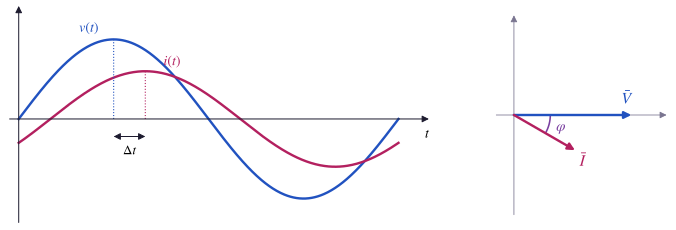
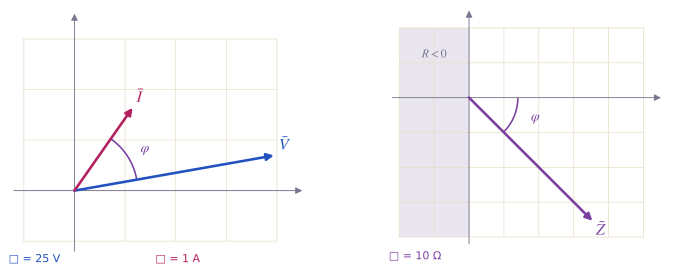
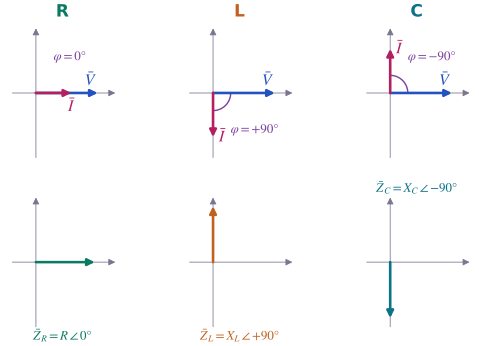
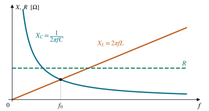
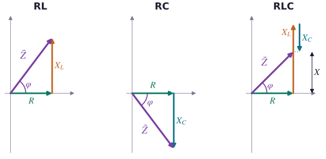
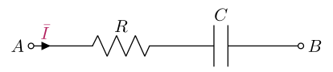
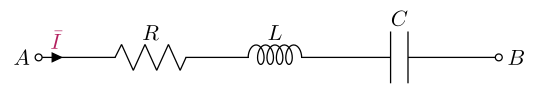
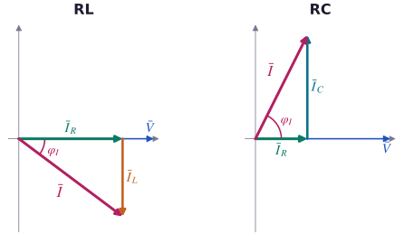
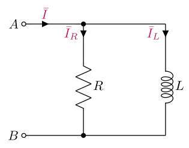
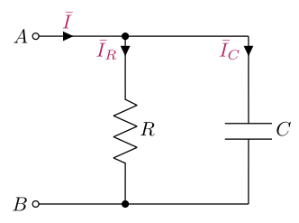

# L'impedenza

### TEEA — 4MAT · Argomento 2

<a class="btn btn-pdf" href="pdf/02-impedenza.pdf" download>Scarica la spiegazione in PDF</a> <a class="btn btn-pdf" href="pdf/02-formulario-impedenza.pdf" download>Scarica il formulario</a>

---

<!-- PDF:INIZIO -->

In continua un resistore si descrive con un solo numero, la resistenza *R*. In alternata un carico fa **due cose**: **limita** la corrente e la **sfasa** rispetto alla tensione. Per descriverlo servono quindi due numeri, un modulo e un angolo: è l'**impedenza**.

In questa lezione si lavora solo con i fasori: moduli, angoli, il teorema di Pitagora e l'arcotangente.

Convenzioni della lezione

- La **lunghezza di un fasore** è il **valore efficace**: la tensione di rete si scrive V̄ = 230 V ∠ 0°, non 325 V ∠ 0°.
- Il **modulo** di un fasore si scrive tra due sbarrette: \|*V*\|, \|*I*\|, \|*Z*\|.
- Gli **angoli** si misurano dall'asse orizzontale in senso antiorario e si danno sempre **tra −180° e +180°**.
- L'angolo dell'impedenza è **φ = φV − φI**: fase della tensione meno fase della corrente.
- In ogni diagramma fasoriale si scrive **quanto vale un quadretto**, per esempio 1 quadretto = 50 V.

In LV01 i fasori erano lunghi quanto l'ampiezza *V*M. Per l'impedenza non cambia nulla: valore massimo e valore efficace differiscono dello stesso fattore √2, quindi il rapporto tra tensione e corrente è lo stesso, *V*M / *I*M = \|*V*\| / \|*I*\|.

## Dalla resistenza all'impedenza

### In continua: basta un numero

Con un generatore di tensione continua la corrente in un resistore si ricava dalla legge di Ohm, *I* = *V* / *R*. Tensione e corrente sono costanti, quindi c'è una sola domanda: **quanta** corrente passa. La risposta dipende da un solo numero, la resistenza *R*.

### In alternata: quanta corrente e quando

Colleghiamo un carico alla rete, 230 V e 50 Hz. Il voltmetro misura 230 V e l'amperometro 4,6 A (valori efficaci): il rapporto è 230 V / 4,6 A = 50 Ω. All'oscilloscopio, però, si vede che la corrente **non raggiunge il massimo insieme alla tensione**: arriva un po' dopo, in ritardo di 30°.

Il carico quindi fa due cose:

- **limita** la corrente, cioè decide **quanto** è grande: il rapporto 230 V / 4,6 A = 50 Ω;
- **sfasa** la corrente, cioè decide **quando** arriva rispetto alla tensione: l'angolo di 30° tra i due fasori.

Un solo numero non basta più: servono un **modulo** e un **angolo**. Questa coppia si chiama **impedenza** e si scrive come un fasore:

> **Impedenza:** Z̄ = \|*Z*\| ∠ *φ*
>
> **Nell'esempio:** Z̄ = 50 Ω ∠ 30°

| | In continua | In alternata |
|---|---|---|
| **Quanta corrente passa?** | *I* = *V* / *R* | \|*I*\| = \|*V*\| / \|*Z*\| |
| **Quando arriva rispetto alla tensione?** | domanda senza senso: tutto è costante | lo dice l'angolo *φ* |
| **Che cosa descrive il carico** | *R*: un numero, in Ω | Z̄ = \|*Z*\| ∠ *φ*: un modulo in Ω e un angolo in gradi |

Il **resistore** è il caso più semplice: la corrente è in fase con la tensione, *φ* = 0°, e l'impedenza coincide con la resistenza, Z̄ = *R* ∠ 0°. Nelle prossime sezioni si vede come si calcola Z̄ e da che cosa dipende il suo angolo.

Prova nel laboratorio

Apri la web app [Corrente alternata](/education/TEEA/4MAT/laboratorio/ca/).

- Lascia la tensione com'è (*V*max = 325 V, cioè 230 V efficaci, e *f* = 50 Hz). Spunta **Impedenza Z (carico)** e scegli **Z libera**.
- Imposta **Modulo \|Z\| = 50 Ω** e **Argomento φZ = 0°**: tensione e corrente sono in fase.
- Porta l'argomento a **+30°**: l'altezza della corrente non cambia, ma la curva si sposta a destra, cioè arriva dopo (**ritardo**). Con **−30°** si sposta a sinistra (**anticipo**).
- Togli la spunta a **Scala verticale automatica**, così la scala resta ferma, e porta il modulo a **100 Ω**: la corrente diventa alta la metà, lo sfasamento resta lo stesso.
- Spunta **Valori efficaci** e leggi *V*eff e *I*eff.

Nel simulatore le fasi iniziali si chiamano θv e θi; in questa lezione le chiamiamo φV e φI. Il cursore dell'argomento va solo da −90° a +90°: il motivo si vede nella prossima sezione.

Hai capito?

- **1.** Un carico con Z̄ = 100 Ω ∠ 30° è collegato alla rete a 230 V. Quanto vale la corrente efficace? È in anticipo o in ritardo sulla tensione?
- **2.** Due carichi, collegati alla stessa tensione, assorbono la stessa corrente efficace. Nel primo la corrente è in fase con la tensione, nel secondo è in ritardo di 60°. Hanno la stessa impedenza?

Risposte

- **1.** \|*I*\| = 230 V / 100 Ω = **2,3 A**, in **ritardo** di 30°, come nell'esempio.
- **2.** **No.** Hanno lo stesso modulo \|*Z*\|, ma angoli diversi: Z̄1 = \|*Z*\| ∠ 0° e Z̄2 = \|*Z*\| ∠ 60°.

## L'impedenza e la legge di Ohm in alternata

### La definizione

L'impedenza di un carico si ricava dai fasori della tensione ai suoi capi e della corrente che lo attraversa:

> **Modulo:** \|*Z*\| = \|*V*\| / \|*I*\|  (in ohm, Ω)
>
> **Angolo:** *φ* = *φ*V − *φ*I  (in gradi)
>
> **Impedenza:** Z̄ = \|*Z*\| ∠ *φ*

- Il **modulo** dice **quanto** il carico limita la corrente: più \|*Z*\| è grande, più la corrente è piccola.
- L'**angolo** dice **di quanto** la corrente è sfasata rispetto alla tensione, e da che parte.
- Se *φ*V − *φ*I esce dall'intervallo tra −180° e +180°, si aggiunge o si toglie 360°. Per esempio 170° − (−170°) = 340° diventa 340° − 360° = −20°.

Z̄ si disegna come un fasore, ma **non rappresenta una sinusoide**. V̄ e Ī ruotano insieme con la stessa velocità *ω*, quindi il rapporto tra le loro lunghezze e l'angolo tra loro restano sempre uguali: Z̄ è un **fasore fermo**. Descrive il carico, non una grandezza che cambia nel tempo, e per questo non ha né un valore istantaneo *z*(*t*) né un valore efficace.

**Esempio.** Ai capi di un carico c'è V̄ = 100 V ∠ 10° e lo attraversa Ī = 2 A ∠ 55°.

- **modulo:** \|*Z*\| = 100 V / 2 A = **50 Ω**
- **angolo:** *φ* = 10° − 55° = **−45°**
- **impedenza:** **Z̄ = 50 Ω ∠ −45°**. La corrente è 45° più avanti della tensione: è **in anticipo** e il carico è **ohmico-capacitivo** (vedi la tabella dei casi più sotto).

Nel disegno ogni fasore ha la sua scala: per la tensione un quadretto vale 25 V, per la corrente 1 A, per l'impedenza 10 Ω. Per questo i fasori di grandezze diverse si possono confrontare solo negli **angoli**, non nelle lunghezze.

### La legge di Ohm in alternata

Come in continua, la legge di Ohm si usa in tre modi, a seconda di che cosa si cerca. Si lavora **separatamente** sui moduli, con moltiplicazioni e divisioni, e sugli angoli, con somme e sottrazioni.

| Si cerca | Modulo | Angolo |
|---|---|---|
| **l'impedenza** Z̄ | \|*Z*\| = \|*V*\| / \|*I*\| | *φ* = *φ*V − *φ*I |
| **la corrente** Ī | \|*I*\| = \|*V*\| / \|*Z*\| | *φ*I = *φ*V − *φ* |
| **la tensione** V̄ | \|*V*\| = \|*Z*\| · \|*I*\| | *φ*V = *φ*I + *φ* |

**Esempio.** Un carico con Z̄ = 40 Ω ∠ 30° è alimentato con V̄ = 120 V ∠ 0°. Quanto vale la corrente?

- **modulo:** \|*I*\| = 120 V / 40 Ω = **3 A**
- **angolo:** *φ*I = 0° − 30° = **−30°**
- **corrente:** **Ī = 3 A ∠ −30°**, in ritardo di 30° sulla tensione

### I cinque casi

Il segno e il valore di *φ* dicono subito che tipo di carico è e se la corrente arriva prima o dopo la tensione.

| Angolo *φ* | Tipo di carico | La corrente è… | Esempio |
|---|---|---|---|
| *φ* = 0° | resistivo puro | in fase con la tensione | resistore, stufetta elettrica |
| 0° < *φ* < +90° | ohmico-induttivo | in ritardo di *φ* | motore, R e L in serie |
| *φ* = +90° | induttivo puro | in ritardo di 90° | induttore ideale |
| −90° < *φ* < 0° | ohmico-capacitivo | in anticipo di \|*φ*\| | R e C in serie |
| *φ* = −90° | capacitivo puro | in anticipo di 90° | condensatore ideale |

> ***φ* positivo** → corrente **in ritardo** → carico **induttivo**
>
> ***φ* negativo** → corrente **in anticipo** → carico **capacitivo**

Per ricordarlo si usa la parola **CIVIL**: nel **C**ondensatore la corrente **I** viene prima della tensione **V**; nell'induttore (**L**) la tensione **V** viene prima della corrente **I**.

### Perché \|*φ*\| non supera 90°

Resistori, induttori e condensatori sono componenti **passivi**: assorbono energia dal generatore. Il resistore la trasforma in calore, induttore e condensatore la accumulano e poi la restituiscono. Con questi componenti l'angolo dell'impedenza resta **sempre tra −90° e +90°**.

Un angolo più grande vorrebbe dire che il carico, in media, **fornisce** energia al generatore, cioè che si comporta a sua volta da generatore. Nel piano dell'impedenza questi casi stanno nel semipiano di sinistra, la zona ombreggiata *R* < 0 della figura.

Se in un esercizio con un carico passivo trovi \|*φ*\| > 90°, ricontrolla il calcolo: l'errore più comune è scrivere *φ*I − *φ*V invece di *φ*V − *φ*I.

Prova nel laboratorio

Apri la web app [Laboratorio delle impedenze](/education/TEEA/4MAT/laboratorio/laboratorio-impedenze/) e scegli il menu **Impedenza da tensione e corrente**.

- Scrivi i valori del primo esempio: tensione **modulo 100 V, fase 10°**; corrente **modulo 2 A, fase 55°**. Controlla che il risultato sia Z̄ = 50 Ω ∠ −45° e leggi i passaggi del calcolo e il tipo di carico.
- Premi uno dopo l'altro i pulsanti di **Esempi pronti** (in fase, in ritardo di 30° e di 90°, in anticipo di 45° e di 90°) e confronta ogni volta l'angolo di Z̄ con la tabella dei cinque casi.
- Nel piano piccolo a destra **trascina la punta di Z̄**: la tensione resta ferma e cambia la corrente. L'angolo si aggancia ai multipli di 15°. Prova a portare Z̄ nella zona ombreggiata: il laboratorio avvisa che con R, L e C non si può.
- Usa questo menu per controllare gli **esercizi 1–4** dell'esercitazione. Nell'esercizio 4 scrivi come corrente quella che hai calcolato e verifica che Z̄ valga 120 Ω ∠ 60°; in alternativa trascina Z̄ finché l'angolo si aggancia a 60° e il modulo arriva a 120 Ω.

Hai capito?

- **1.** Ai capi di un carico c'è V̄ = 50 V ∠ 0° e lo attraversa Ī = 5 A ∠ 90°. Quanto vale Z̄? Che tipo di carico è?
- **2.** Un carico con Z̄ = 46 Ω ∠ −60° è collegato a V̄ = 230 V ∠ 0°. Calcola Ī. La corrente è in anticipo o in ritardo?
- **3.** Per un carico fatto di un resistore e un induttore in serie, un compagno trova *φ* = −30°. Che cosa gli diresti?

Risposte

- **1.** \|*Z*\| = 50 V / 5 A = 10 Ω e *φ* = 0° − 90° = −90°, quindi **Z̄ = 10 Ω ∠ −90°**: carico **capacitivo puro**, corrente in anticipo di 90°.
- **2.** \|*I*\| = 230 V / 46 Ω = 5 A e *φ*I = 0° − (−60°) = +60°, quindi **Ī = 5 A ∠ 60°**, **in anticipo** di 60°.
- **3.** Che c'è un errore di segno: un resistore con un induttore è un carico **ohmico-induttivo**, quindi *φ* deve essere **positivo**. Probabilmente ha calcolato *φ*I − *φ*V; con *φ*V − *φ*I trova *φ* = +30°.

## I tre componenti ideali

Ogni carico in alternata si può costruire con tre componenti di base: **resistore**, **induttore** e **condensatore**. Qui li consideriamo **ideali**, cioè con una sola proprietà ciascuno: un induttore reale, per esempio, ha anche la resistenza del filo dell'avvolgimento, e il suo angolo è un po' meno di 90°.

### Il resistore

- Tensione e corrente sono **in fase**: *φ* = 0°.
- L'impedenza è la resistenza stessa: **Z̄R = *R* ∠ 0°**.
- *R* **non dipende dalla frequenza**: il resistore si comporta allo stesso modo in continua e in alternata.

### L'induttore

- La corrente è **in ritardo di 90°** sulla tensione, cioè di un quarto di periodo: *φ* = +90°.
- Il modulo dell'impedenza si chiama **reattanza induttiva** *X*L:

> **Reattanza induttiva:** *X*L = 2π · *f* · *L* = *ω* · *L*  (*X*L in Ω, *f* in Hz, *L* in henry, H)
>
> **Impedenza:** Z̄L = *X*L ∠ +90°

- *X*L è **proporzionale alla frequenza**: se *f* raddoppia, anche *X*L raddoppia. L'induttore si oppone ai cambiamenti della corrente, e più la corrente cambia in fretta più si oppone.
- **In continua** (*f* = 0) *X*L = 0: l'induttore è un **cortocircuito**, si comporta come un filo.

### Il condensatore

- La corrente è **in anticipo di 90°** sulla tensione, cioè di un quarto di periodo: *φ* = −90°.
- Il modulo dell'impedenza si chiama **reattanza capacitiva** *X*C:

> **Reattanza capacitiva:** *X*C = 1 / (2π · *f* · *C*) = 1 / (*ω* · *C*)  (*X*C in Ω, *f* in Hz, *C* in farad, F)
>
> **Impedenza:** Z̄C = *X*C ∠ −90°

- *X*C è **inversamente proporzionale alla frequenza**: se *f* raddoppia, *X*C si dimezza. Il condensatore si carica e si scarica a ogni semiperiodo, e più lo fa in fretta più corrente passa.
- **In continua** (*f* = 0) *X*C diventa infinita: il condensatore, una volta carico, è un **circuito aperto** e non lascia passare corrente.

**Attenzione alle unità.** Nelle formule *L* va in henry e *C* in farad: 1 mH = 10−3 H, 1 µF = 10−6 F, 1 nF = 10−9 F.

### Reattanza e impedenza non sono la stessa cosa

- La **reattanza** (*X*L o *X*C) è un **numero** in ohm: dice **quanto** il componente limita la corrente.
- L'**impedenza** (Z̄L o Z̄C) è un **fasore**: dice quanto, ma anche **come** il componente sfasa la corrente. Il suo modulo è la reattanza, \|*Z*L\| = *X*L e \|*Z*C\| = *X*C.

Scrivere «Z̄L = 62,8 Ω» è quindi incompleto: manca l'angolo. La forma giusta è *X*L = 62,8 Ω oppure Z̄L = 62,8 Ω ∠ 90°.

| Componente | Modulo | Impedenza | La corrente è… | Se *f* aumenta | In continua |
|---|---|---|---|---|---|
| **resistore** | *R* | *R* ∠ 0° | in fase | *R* non cambia | *R* |
| **induttore** | *X*L = 2π*fL* | *X*L ∠ +90° | in ritardo di 90° | *X*L cresce | cortocircuito |
| **condensatore** | *X*C = 1 / (2π*fC*) | *X*C ∠ −90° | in anticipo di 90° | *X*C diminuisce | circuito aperto |

### Come cambiano le reattanze con la frequenza

- *R* è una **retta orizzontale**: non dipende da *f*.
- *X*L è una **retta che parte dall'origine**: vale zero in continua e cresce sempre.
- *X*C è un'**iperbole**: è enorme alle basse frequenze e si avvicina a zero alle alte.

C'è una frequenza, *f*0, in cui *X*L e *X*C sono uguali: è la **frequenza di risonanza**, che servirà nei circuiti in serie.

**Esempio 1.** Un induttore da *L* = 200 mH è collegato alla rete, 230 V e 50 Hz.

- **reattanza:** *X*L = 2π · 50 Hz · 0,2 H ≈ **62,8 Ω**
- **impedenza:** **Z̄L = 62,8 Ω ∠ 90°**
- **corrente** (legge di Ohm, con V̄ = 230 V ∠ 0°): \|*I*\| = 230 V / 62,8 Ω ≈ 3,66 A e *φ*I = 0° − 90° = −90°, quindi **Ī ≈ 3,66 A ∠ −90°**
- **a 100 Hz:** *X*L ≈ 125,7 Ω, il doppio

**Esempio 2.** Un condensatore da *C* = 47 µF a 50 Hz.

- **reattanza:** *X*C = 1 / (2π · 50 Hz · 47 · 10−6 F) ≈ **67,7 Ω**
- **impedenza:** **Z̄C = 67,7 Ω ∠ −90°**
- **a 100 Hz:** *X*C ≈ 33,9 Ω, la metà

### Le formule inverse

Dalle due formule della reattanza si ricava una qualsiasi delle grandezze, quando si conoscono le altre due:

> **Induttore:** *f* = *X*L / (2π · *L*) &emsp; *L* = *X*L / (2π · *f*)
>
> **Condensatore:** *f* = 1 / (2π · *C* · *X*C) &emsp; *C* = 1 / (2π · *f* · *X*C)

**Esempio 3.** A quale frequenza l'induttore da 200 mH ha una reattanza di 100 Ω? *f* = 100 Ω / (2π · 0,2 H) ≈ **79,6 Hz**.

Prova nel laboratorio

Nella web app [Corrente alternata](/education/TEEA/4MAT/laboratorio/ca/):

- spunta **Impedenza Z (carico)**, scegli **Induttore** e togli la spunta a **Scala verticale automatica**;
- aumenta la **frequenza f**: la corrente diventa sempre più piccola, ma resta in ritardo di 90°;
- scegli **Condensatore** e ripeti: ora la corrente **cresce** con la frequenza e resta in anticipo di 90°.

Nel [Laboratorio delle impedenze](/education/TEEA/4MAT/laboratorio/laboratorio-impedenze/), menu **Impedenza dei componenti**:

- scegli **L**, scrivi *L* in mH e cambia *f*: sotto il valore di *L* compare *X*L = *ωL* e sotto la frequenza il valore di *ω* = 2π*f*. Fai lo stesso con **C** (in µF);
- controlla così gli **esercizi 5–7**. La frequenza si scrive in Hz (1 kHz = 1000 Hz). Nell'esercizio 7 scrivi la frequenza che hai calcolato e verifica che la reattanza valga 100 Ω.

Hai capito?

- **1.** Un induttore ha *X*L = 40 Ω a 50 Hz. Quanto vale la reattanza a 150 Hz? E quella di un condensatore che a 50 Hz ha *X*C = 40 Ω?
- **2.** Un compagno scrive Z̄C = 50 Ω. Che cosa manca?
- **3.** Un generatore in continua da 12 V alimenta una lampadina con un condensatore in serie. La lampadina resta accesa? E se al posto del condensatore c'è un induttore?

Risposte

- **1.** La frequenza triplica: *X*L triplica e diventa **120 Ω**; *X*C diventa un terzo, **13,3 Ω** circa.
- **2.** L'angolo: 50 Ω è la reattanza *X*C, l'impedenza è **Z̄C = 50 Ω ∠ −90°**.
- **3.** Con il condensatore **no**: appena si è caricato è un circuito aperto e la corrente si ferma. Con l'induttore **sì**: in continua è un cortocircuito, come se non ci fosse.

## Circuiti in serie: il triangolo dell'impedenza

### La regola della serie

In serie tutti i componenti sono attraversati dalla **stessa corrente** Ī. Le loro impedenze si sommano **come fasori**, cioè mettendole **punta-coda**: Z̄ = Z̄R + Z̄L + Z̄C.

La resistenza è orizzontale e le reattanze sono verticali, quindi la somma forma un triangolo rettangolo, il **triangolo dell'impedenza**: i cateti sono *R* e la reattanza totale *X*, l'ipotenusa è Z̄.

> **Modulo (Pitagora):** \|*Z*\| = √(*R*² + *X*²)
>
> **Angolo:** *φ* = arctan(*X* / *R*)
>
> **Reattanza totale:** *X* = *X*L (RL)  ·  *X* = −*X*C (RC)  ·  *X* = *X*L − *X*C (RLC)

**Attenzione: i moduli non si sommano.** Un resistore da 60 Ω in serie con una reattanza da 80 Ω non dà 140 Ω, ma 100 Ω. I moduli si sommano solo quando i fasori hanno lo stesso angolo, come per più resistori in serie.

Lo stesso vale per le **tensioni**: moltiplicando ogni lato del triangolo per \|*I*\| si ottiene il triangolo delle tensioni, con *V*R = *R* · \|*I*\| e *V*L = *X*L · \|*I*\|. Se misuri con il voltmetro le tensioni sui singoli componenti, la loro somma è **più grande** della tensione totale: va fatta con Pitagora.

### Circuito RL serie

**Esempio.** *R* = 60 Ω e *L* = 127,3 mH in serie, alla frequenza *f* = 100 Hz.

- **reattanza:** *X*L = 2π · 100 Hz · 0,1273 H ≈ **80 Ω**
- **modulo:** \|*Z*\| = √(60² + 80²) = **100 Ω**
- **angolo:** *φ* = arctan(80 / 60) ≈ **53,1°**
- **impedenza:** **Z̄ = 100 Ω ∠ 53,1°**, carico **ohmico-induttivo**
- **con \|*V*\| = 50 V:** \|*I*\| = 50 V / 100 Ω = 0,5 A, in ritardo di 53,1°. Sui componenti ci sono *V*R = 30 V e *V*L = 40 V: 30 + 40 = 70 V, ma √(30² + 40²) = 50 V, come deve essere.

### Circuito RC serie

Il fasore di *X*C punta verso il basso, quindi la reattanza totale è negativa, *X* = −*X*C, e l'angolo esce negativo.

**Esempio.** *R* = 30 Ω in serie con un condensatore che ha *X*C = 40 Ω (per esempio *C* = 79,6 µF a 50 Hz).

- **reattanza totale:** *X* = −40 Ω
- **modulo:** \|*Z*\| = √(30² + 40²) = **50 Ω**
- **angolo:** *φ* = arctan(−40 / 30) ≈ **−53,1°**
- **impedenza:** **Z̄ = 50 Ω ∠ −53,1°**, carico **ohmico-capacitivo**: la corrente è in anticipo di 53,1°

### Circuito RLC serie

*X*L punta verso l'alto e *X*C verso il basso: le due reattanze **si sottraggono**, *X* = *X*L − *X*C. È il segno di *X* a decidere il tipo di carico:

- *X* > 0: prevale l'induttore, il circuito è **ohmico-induttivo**;
- *X* < 0: prevale il condensatore, il circuito è **ohmico-capacitivo**;
- *X* = 0: le reattanze si annullano e il circuito è **resistivo** (è la risonanza, nel paragrafo che segue).

**Esempio.** *R* = 50 Ω, *X*L = 20 Ω e *X*C = 70 Ω in serie.

- **reattanza totale:** *X* = 20 Ω − 70 Ω = **−50 Ω**: prevale il condensatore
- **modulo:** \|*Z*\| = √(50² + 50²) ≈ **70,7 Ω**
- **angolo:** *φ* = arctan(−50 / 50) = **−45°**
- **impedenza:** **Z̄ ≈ 70,7 Ω ∠ −45°**, carico **ohmico-capacitivo**
- **con 230 V:** \|*I*\| = 230 V / 70,7 Ω ≈ 3,25 A, in anticipo di 45°

### La risonanza

*X*L cresce con la frequenza e *X*C diminuisce, quindi c'è una frequenza in cui sono uguali: è l'incrocio *f*0 nel grafico delle reattanze. Uguagliando 2π*fL* = 1 / (2π*fC*) si ottiene:

> **Frequenza di risonanza:** *f*0 = 1 / (2π · √(*L* · *C*))

Alla frequenza di risonanza, in un circuito RLC serie:

- la reattanza totale è nulla, *X* = 0, e l'impedenza è solo la resistenza: **Z̄ = *R* ∠ 0°**;
- \|*Z*\| è **la più piccola possibile**, quindi la corrente è **la più grande possibile**, \|*I*\| = \|*V*\| / *R*;
- la corrente è **in fase** con la tensione.

**Sotto** *f*0 prevale il condensatore e il circuito è ohmico-capacitivo; **sopra** *f*0 prevale l'induttore e il circuito è ohmico-induttivo. È il principio con cui un circuito «sceglie» una frequenza, per esempio quando una radio si sintonizza su una stazione.

**Esempio.** *R* = 10 Ω, *L* = 40 mH e *C* = 4,7 µF in serie, alimentati con 10 V.

- **risonanza:** *f*0 = 1 / (2π · √(0,04 H · 4,7 · 10−6 F)) ≈ **367 Hz**
- **a *f*0:** Z̄ = 10 Ω ∠ 0° e \|*I*\| = 10 V / 10 Ω = **1 A**, in fase
- **a 1 kHz:** *X*L ≈ 251,3 Ω e *X*C ≈ 33,9 Ω, quindi *X* ≈ 217,5 Ω, \|*Z*\| ≈ 217,7 Ω e *φ* ≈ 87,4°: il circuito è quasi puramente induttivo e la corrente scende a circa 46 mA

Prova nel laboratorio

Nel [Laboratorio delle impedenze](/education/TEEA/4MAT/laboratorio/laboratorio-impedenze/), menu **Impedenza dei componenti**:

- scegli **RL** e **In serie**, poi *f* = 100 Hz, *R* = 60 Ω e *L* = 127,3 mH: le frecce di *R* e *X*L sono già punta-coda e Z̄ vale circa 100 Ω ∠ 53,1°. Trascina la punta di una freccia e guarda come cambia il triangolo;
- scegli **RLC** e **In serie** con *R* = 10 Ω, *L* = 40 mH e *C* = 4,7 µF, poi premi **Porta f alla risonanza**: Z̄ si appoggia sull'asse orizzontale. Sposta *f* sotto e sopra *f*0 e guarda da che parte va Z̄;
- controlla gli **esercizi 8–11** con le impostazioni indicate nell'esercitazione.

Nella web app [Corrente alternata](/education/TEEA/4MAT/laboratorio/ca/) scegli **RLC serie**, togli la spunta a **Scala verticale automatica** e premi **Porta f alla risonanza**: la corrente è la più alta possibile e in fase con la tensione. Allontanandoti da *f*0, in un verso o nell'altro, si abbassa e si sfasa.

Hai capito?

- **1.** In un circuito RL serie *R* = 30 Ω e *X*L = 40 Ω. Quanto valgono \|*Z*\| e *φ*?
- **2.** In un circuito RL serie il voltmetro misura 6 V sul resistore e 8 V sull'induttore. Quanto vale la tensione ai capi della serie?
- **3.** Un circuito RLC serie ha *R* = 20 Ω e *X*L = *X*C = 100 Ω ed è alimentato con 100 V. Quanto vale la corrente? Com'è sfasata?

Risposte

- **1.** \|*Z*\| = √(30² + 40²) = **50 Ω** e *φ* = arctan(40 / 30) ≈ **53,1°**.
- **2.** **10 V**, non 14 V: le due tensioni sono sfasate di 90° e si sommano con Pitagora, √(6² + 8²) = 10 V.
- **3.** Le reattanze si annullano: il circuito è in risonanza e Z̄ = 20 Ω ∠ 0°. La corrente è **5 A, in fase** con la tensione.

## Circuiti in parallelo: il triangolo delle correnti

### La regola del parallelo

In parallelo tutti i rami hanno ai capi la **stessa tensione** V̄, che si prende come riferimento a 0°. Ogni ramo assorbe la sua corrente, calcolata con la legge di Ohm, e la sfasa a modo suo:

- nel **resistore** ĪR = \|*V*\| / *R*, **in fase** con la tensione (0°);
- nell'**induttore** ĪL = \|*V*\| / *X*L, **in ritardo di 90°** (−90°);
- nel **condensatore** ĪC = \|*V*\| / *X*C, **in anticipo di 90°** (+90°).

La corrente totale è la **somma delle correnti dei rami**, fatta con i fasori punta-coda. Anche qui si forma un triangolo rettangolo, il **triangolo delle correnti**: i cateti sono *I*R e la corrente reattiva, l'ipotenusa è Ī. Dalla corrente totale si ricava poi l'impedenza con la legge di Ohm.

> **Corrente totale:** \|*I*\| = √(*I*R² + (*I*C − *I*L)²)  (senza C si pone *I*C = 0, senza L *I*L = 0)
>
> **Angolo della corrente:** *φ*I = arctan((*I*C − *I*L) / *I*R)
>
> **Impedenza:** \|*Z*\| = \|*V*\| / \|*I*\|  e  *φ* = *φ*V − *φ*I = −*φ*I

**Attenzione: in parallelo le impedenze non si mettono punta-coda.** Si sommano le correnti, non le impedenze. Per questo l'impedenza del parallelo è **più piccola** di quella di ciascun ramo: ogni ramo in più offre alla corrente una strada in più.

### Circuito RL parallelo

**Esempio.** *R* = 60 Ω e un induttore con *X*L = 80 Ω in parallelo, alimentati con V̄ = 240 V ∠ 0°.

- **correnti dei rami:** *I*R = 240 V / 60 Ω = **4 A** (a 0°) e *I*L = 240 V / 80 Ω = **3 A** (a −90°)
- **corrente totale:** \|*I*\| = √(4² + 3²) = **5 A** e *φ*I = arctan(−3 / 4) ≈ **−36,9°**
- **impedenza:** \|*Z*\| = 240 V / 5 A = **48 Ω** e *φ* = 0° − (−36,9°) = **+36,9°**, quindi **Z̄ = 48 Ω ∠ 36,9°**, carico **ohmico-induttivo**

48 Ω è meno sia di 60 Ω sia di 80 Ω, come deve essere in parallelo.

### Circuito RC parallelo

**Esempio.** *R* = 50 Ω e un condensatore con *X*C = 20 Ω in parallelo, alimentati con V̄ = 100 V ∠ 0°.

- **correnti dei rami:** *I*R = 100 V / 50 Ω = **2 A** (a 0°) e *I*C = 100 V / 20 Ω = **5 A** (a +90°)
- **corrente totale:** \|*I*\| = √(2² + 5²) ≈ **5,39 A** e *φ*I = arctan(5 / 2) ≈ **68,2°**
- **impedenza:** \|*Z*\| = 100 V / 5,39 A ≈ **18,6 Ω** e *φ* ≈ **−68,2°**, quindi **Z̄ ≈ 18,6 Ω ∠ −68,2°**, carico **ohmico-capacitivo**

### Circuito RLC parallelo

ĪL punta verso il basso e ĪC verso l'alto: le due correnti **si sottraggono**, e conta la differenza *I*C − *I*L. In parallelo prevale il componente con la reattanza **più piccola**, perché è quello che assorbe più corrente: è il contrario di quello che succede in serie.

**Esempio.** *R* = 100 Ω, *X*L = 50 Ω e *X*C = 25 Ω in parallelo, con V̄ = 100 V ∠ 0°.

- **correnti dei rami:** *I*R = 1 A, *I*L = 2 A, *I*C = 4 A, quindi *I*C − *I*L = 2 A: prevale il condensatore
- **corrente totale:** \|*I*\| = √(1² + 2²) ≈ **2,24 A** e *φ*I = arctan(2 / 1) ≈ **63,4°**
- **impedenza:** \|*Z*\| = 100 V / 2,24 A ≈ **44,7 Ω** e *φ* ≈ **−63,4°**: carico **ohmico-capacitivo**

Quando *X*L = *X*C le correnti di L e C sono uguali e opposte e si compensano: la corrente totale è solo *I*R, la più piccola possibile, e l'impedenza vale *R*, la più grande possibile. È la **risonanza del parallelo**, alla stessa frequenza *f*0 = 1 / (2π√(*LC*)) della serie, ma con l'effetto opposto.

Prova nel laboratorio

Nel [Laboratorio delle impedenze](/education/TEEA/4MAT/laboratorio/laboratorio-impedenze/), menu **Impedenza dei componenti**:

- scegli **RL** e **In parallelo** con *f* = 50 Hz, *R* = 60 Ω e *L* = 254,6 mH (cioè *X*L = 80 Ω): Z̄ vale circa 48 Ω ∠ 36,9°, come nell'esempio;
- guarda il piano: le impedenze dei rami sono **tratteggiate** perché in parallelo non si mettono punta-coda. Il laboratorio mostra le impedenze, non le correnti: **il triangolo delle correnti va disegnato su carta**, e il laboratorio serve per controllare \|*Z*\| e *φ*;
- prova **RLC** in parallelo e premi **Porta f alla risonanza**: Z̄ si appoggia sull'asse orizzontale e il suo modulo diventa il più grande possibile;
- controlla gli **esercizi 12 e 13** con le impostazioni indicate nell'esercitazione.

Hai capito?

- **1.** Un resistore da 30 Ω e un induttore con *X*L = 40 Ω sono in parallelo a 120 V. Calcola le correnti dei rami, la corrente totale e Z̄.
- **2.** Due rami in parallelo assorbono 3 A e 4 A. Perché la corrente totale non è 7 A?
- **3.** In un RLC parallelo *X*L = 20 Ω e *X*C = 80 Ω. Il circuito è ohmico-induttivo o ohmico-capacitivo? E se fossero in serie?

Risposte

- **1.** *I*R = 4 A e *I*L = 3 A; \|*I*\| = 5 A con *φ*I ≈ −36,9°; **Z̄ = 24 Ω ∠ 36,9°**.
- **2.** Perché le due correnti sono sfasate: si sommano come fasori. Se fossero sfasate di 90° la somma sarebbe √(3² + 4²) = 5 A; si arriva a 7 A solo se sono in fase, per esempio con due resistori.
- **3.** In parallelo prevale la reattanza più piccola, cioè l'induttore: **ohmico-induttivo**. In serie prevale la più grande, cioè il condensatore: **ohmico-capacitivo**.

## Riepilogo

- L'impedenza **Z̄ = \|*Z*\| ∠ *φ*** descrive un carico in alternata: il modulo \|*Z*\| = \|*V*\| / \|*I*\| dice quanto limita la corrente, l'angolo *φ* = *φ*V − *φ*I di quanto la sfasa.
- *φ* > 0: carico induttivo, corrente in ritardo. *φ* < 0: carico capacitivo, corrente in anticipo. Con R, L e C \|*φ*\| non supera 90°.
- Resistore *R* ∠ 0°; induttore *X*L ∠ +90°, con *X*L = 2π*fL* che cresce con *f*; condensatore *X*C ∠ −90°, con *X*C = 1 / (2π*fC*) che diminuisce con *f*.
- **In serie** si sommano le impedenze punta-coda: triangolo dell'impedenza, \|*Z*\| = √(*R*² + *X*²) e *φ* = arctan(*X* / *R*). Alla risonanza *X*L = *X*C e la corrente è massima.
- **In parallelo** si sommano le correnti dei rami: triangolo delle correnti, poi Z̄ si ricava con la legge di Ohm.

<!-- PDF:FINE -->

**Per andare avanti.** *R* e *X* sono le proiezioni di Z̄ sugli assi orizzontale e verticale. La spunta **forma complessa** del Laboratorio delle impedenze le usa già: servirà nella lezione sui numeri complessi.

---

📐 Tutte le formule in una pagina: [formulario dell'impedenza](pdf/02-formulario-impedenza.pdf).

✏️ Per allenarti: [esercitazione su impedenze e fasori](/education/TEEA/4MAT/materiali/esercitazione-impedenze-4MAT.pdf) (13 esercizi) e [soluzioni](/education/TEEA/4MAT/materiali/soluzioni-esercitazione-impedenze-4MAT.pdf).

➡️ Per verificare i risultati usa le web app [Laboratorio delle impedenze](/education/TEEA/4MAT/laboratorio/laboratorio-impedenze/) e [Corrente alternata](/education/TEEA/4MAT/laboratorio/ca/).

[← Torna a TEEA — 4MAT](/education/TEEA/4MAT/)
